<div align="center">

<picture>
  <source media="(prefers-color-scheme: dark)" srcset="public/assets/branding/everfolk-wordmark-cream@2x.png">
  <source media="(prefers-color-scheme: light)" srcset="public/assets/branding/everfolk-wordmark-ink@2x.png">
  
</picture>

### A Storybook Life Simulation in Ancient Alexandria & Earned Living-Legacy NFTs on NEAR

<p>
  <a href="https://everfolk.life"></a>
  <a href="https://beta.everfolk.life"></a>
  <a href="https://everfolk.life/test/weave/granary"></a>
  <a href="https://everfolk.life/#market"></a>
  <a href="https://everfolk.life/skills"></a>
  <a href="https://beta.everfolk.life/cards"></a>
  <a href="https://beta.everfolk.life/showcase/pack"></a>
  <a href="https://testnet.nearblocks.io/address/everfolk-cards-11140224.testnet"></a>
</p>

<p>
  <a href="https://github.com/kvnhoag/everfolk/actions/workflows/ci.yml"></a>
  
  
  
  
</p>

<p>
  <a href="#product-showcase">Showcase</a> &middot;
  <a href="#current-artwork--illustrated-guide">Artwork &amp; Guide</a> &middot;
  <a href="#current-gameplay">Current Gameplay</a> &middot;
  <a href="#how-living-legacies-work">How It Works</a> &middot;
  <a href="#nfts--historical-collectibles">NFTs &amp; Figures</a> &middot;
  <a href="#smart-contracts--protocol-parameters">Contracts &amp; Tokenomics</a> &middot;
  <a href="#architecture--system-design">Architecture</a> &middot;
  <a href="#skill-atlas--economy">Skill Atlas</a> &middot;
  <a href="#npc-companions--agent-runtime">NPC Agents</a> &middot;
  <a href="#assets-typography--attributions">Asset Library</a> &middot;
  <a href="#quickstart">Quickstart</a> &middot;
  <a href="#development--deployment">Deployment</a>
</p>

</div>

---

**Everfolk** is a deterministic browser-based life simulation set around Rhakotis and the emerging city of Alexandria. Begin a life between 400 and 300 BCE, grow into a livelihood, care for a household, and pursue historical work whose consequences outlast the character.

This README describes the current `dev` branch. The `dev` branch deploys to [beta.everfolk.life](https://beta.everfolk.life); [everfolk.life](https://everfolk.life) follows `main`. New free-play births use `alexandria-lives-11`; existing lives retain their exact world revision. Weave Mode uses `alexandria-weave-1`, built from the same current figure-path world with NEAR-backed draws and verification.

In **Free Play**, every life runs locally from a seed and command log with zero account setup. In **Weave Mode**, the same historical achievements can become **Living-Legacy NFTs** on NEAR testnet:

1. **Verifiable Genesis:** `start_life` assigns a seed from NEAR block randomness and records the chosen world revision on chain.
2. **Cross-Life Influence:** At pivotal choices, `draw_npc` selects prior NFTs by category and Affection; rarity scales the impact of their deeds.
3. **Proof Before Minting:** The verifier replays the save against its seed, 5-year checkpoints and recorded draws, then signs the cards actually earned on historical paths. Open a pack of up to five earned candidates without a mint fee, inspect them, and pay when minting one selected card. A life with no earned cards has no pack to mint.
4. **Influence Royalties (`NEP-199`):** Prior NFTs whose deeds affected the life become sources of the minted card. The protocol allocates **50% of mint fees** and **5% of secondary sale proceeds** to upstream owners in proportion to recorded impact.

---

## Product Showcase

The current `dev` branch includes these entry points; use the beta deployment for published changes or the same paths on your local server:

| Experience | What to Explore |
|---|---|
| [Card gallery (`/cards`)](https://beta.everfolk.life/cards) | Browse 117 illustrated figure and contributor designs, their ranks and card details. |
| [Pack showcase (`/showcase/pack`)](https://beta.everfolk.life/showcase/pack) | Open five distinct random preview cards with at least one Legendary, inspect them and open another pack. Preview draws do not award or mint cards. |
| [Household showcase (`/showcase/royalty`)](https://beta.everfolk.life/showcase/royalty) | Choose among six royal and aristocratic scenarios, explore council decisions or try the newborn welcome. Progress stays in the showcase session. |
| [Skill Atlas (`/skills`)](https://beta.everfolk.life/skills) | Explore the 74-node map, prerequisites, demonstrated work and practical rewards. |

The homepage image below is retained from an earlier build. The four showcase panels are fresh captures from the beta on **15 November 2026**, showing the current scene artwork, pack reveal, skill map and card gallery.

<a href="https://everfolk.life">
  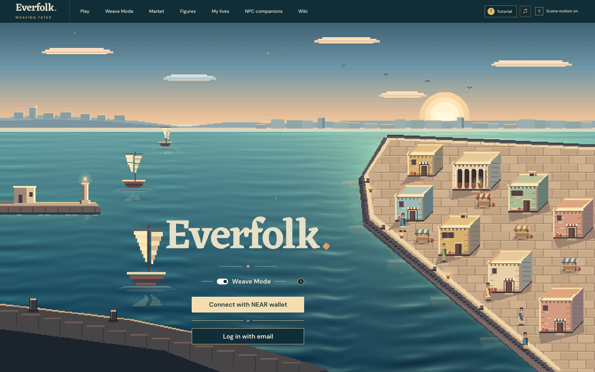
</a>

<table>
  <tr>
    <td width="50%" valign="top">
      <a href="https://beta.everfolk.life/">
        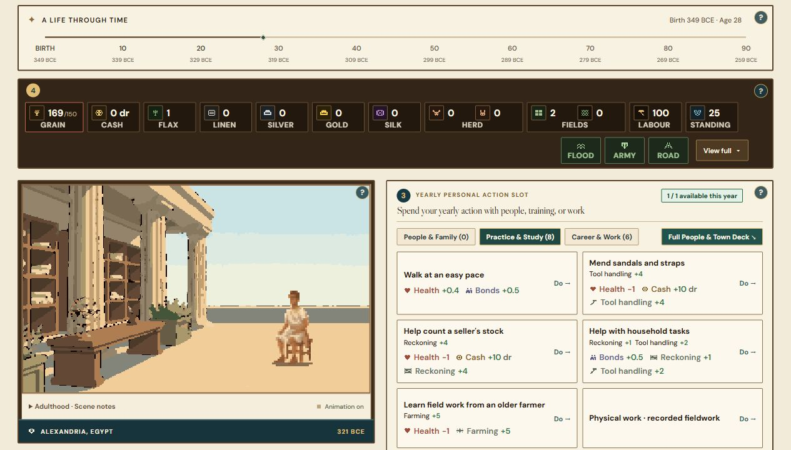
      </a>
      <p align="center"><b>Storybook Life &amp; Household Choices</b><br><sub>New scene artwork frames a life's timeline, household resources and yearly choices for study, work and relationships.</sub></p>
    </td>
    <td width="50%" valign="top">
      <a href="https://beta.everfolk.life/showcase/pack">
        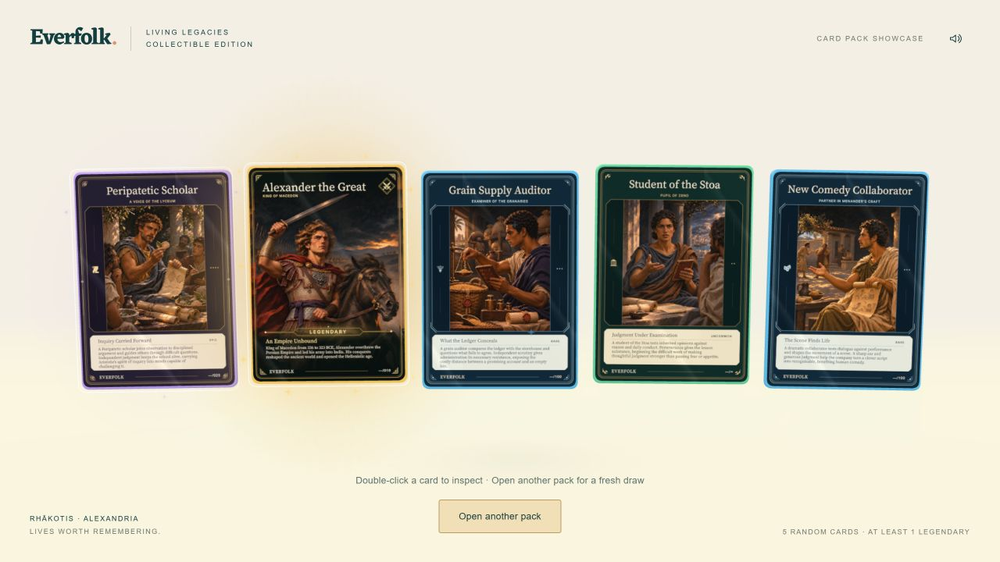
      </a>
      <p align="center"><b>Five-Card Pack Reveal (<code>/showcase/pack</code>)</b><br><sub>Tear the foil pack and inspect five preview cards, including at least one Legendary. Played lives earn their cards through historical paths.</sub></p>
    </td>
  </tr>
  <tr>
    <td width="50%" valign="top">
      <a href="https://beta.everfolk.life/skills">
        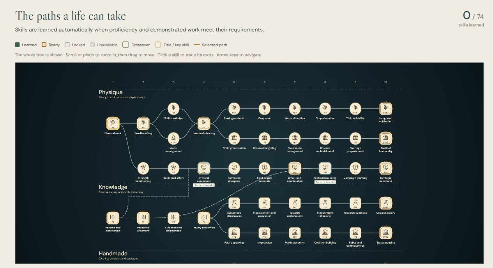
      </a>
      <p align="center"><b>74-Node Skill Atlas (<code>/skills</code>)</b><br><sub>Explore prerequisites, demonstrated work and military crossovers across four branches and ten depths on the current dark skill map.</sub></p>
    </td>
    <td width="50%" valign="top">
      <a href="https://beta.everfolk.life/cards">
        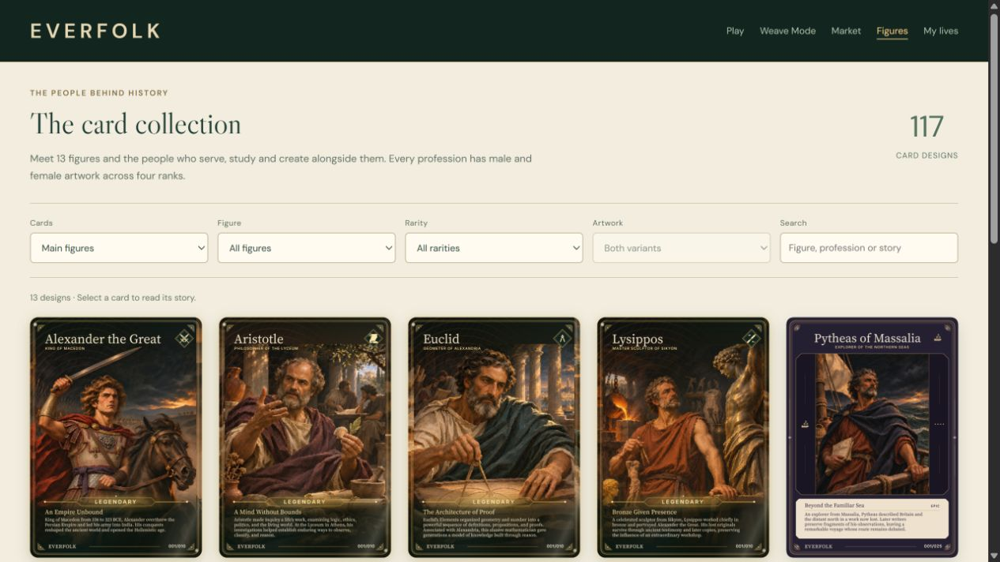
      </a>
      <p align="center"><b>117-Design Card Gallery (<code>/cards</code>)</b><br><sub>Browse 13 historical figures and four contributor ranks in male and female variants, with rarity filters and individual card stories.</sub></p>
    </td>
  </tr>
</table>

### Current Artwork & Illustrated Guide

The delivered v3 portrait library follows six character identities through six visual stages, with clothing for work, scholarship, seafaring, military service, performance, commerce and elite households. These examples follow one identity from infancy to later life:

<table>
  <tr>
    <td width="16%" align="center"><br><sub>Infant</sub></td>
    <td width="16%" align="center">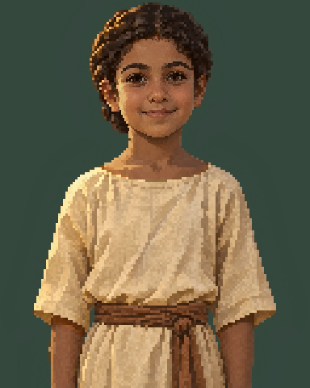<br><sub>Child</sub></td>
    <td width="16%" align="center">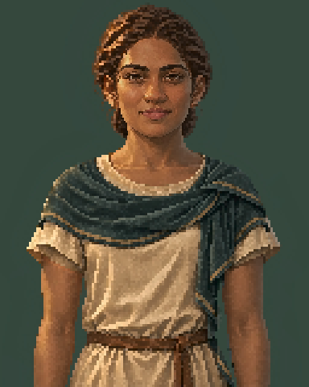<br><sub>Youth</sub></td>
    <td width="16%" align="center">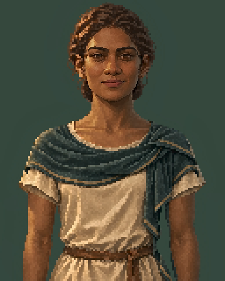<br><sub>Adult</sub></td>
    <td width="16%" align="center">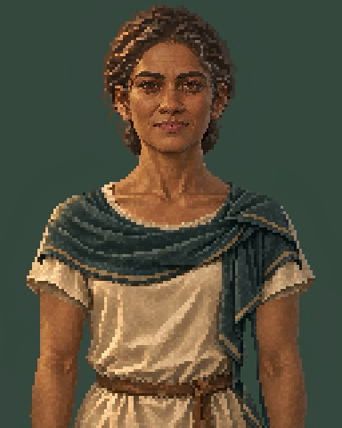<br><sub>Middle age</sub></td>
    <td width="16%" align="center">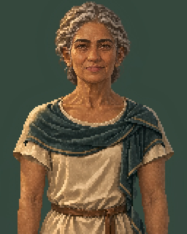<br><sub>Elder</sub></td>
  </tr>
</table>

The current Concept 1 scene library supplies 24 illustrated plates and 1,296 transparent actor sprites on a 480×224 canvas. The sunlit scene artwork covers six life stages and four career roles, with variants for eight household origins, both sexes and three appearances. The retained SVG library supplies 24 scene plates and 864 actor poses as fallbacks, with editable native masters and provenance preserved separately.

<table>
  <tr>
    <td width="33%" align="center">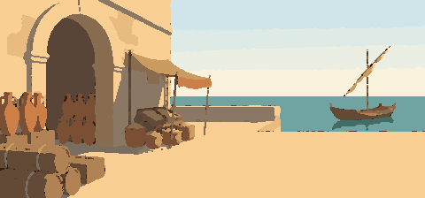<br><sub>Harbor</sub></td>
    <td width="33%" align="center"><br><sub>Study</sub></td>
    <td width="33%" align="center">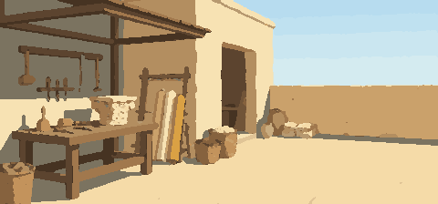<br><sub>Workshop</sub></td>
  </tr>
</table>

The in-game **How to play** guide uses six screenshots of the actual controls and examples calculated from the current life. Its second page, **Your life**, maps the five gameplay stages and opens a guide for each one. The clock waits while the guide is open; its settings control contextual tips and whether it opens at each start.

<table>
  <tr>
    <td width="50%" valign="top">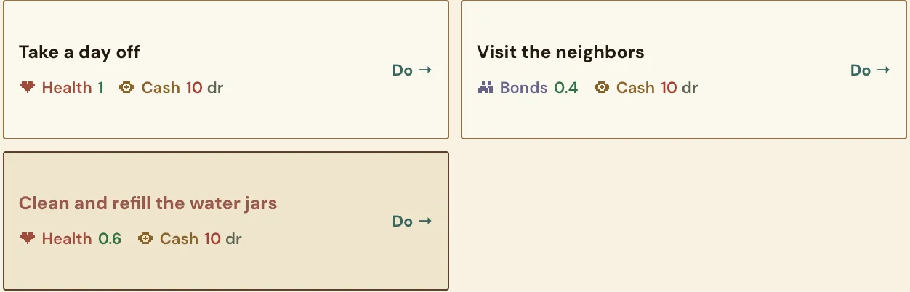<p align="center"><sub>Choose a yearly action</sub></p></td>
    <td width="50%" valign="top">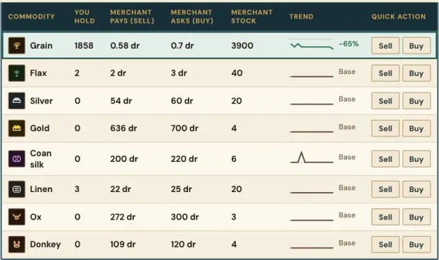<p align="center"><sub>Preview a market order</sub></p></td>
  </tr>
</table>

---

## Current Gameplay

- **Choose a mode:** Start Free Play without an account, or use the home menu's Weave Mode option to connect a NEAR wallet or sign in by email. Return to an existing life through the menu's continuation controls.
- **A life that opens gradually:** Roll a character and household, then reveal controls as they become useful. The visible timeline groups early years (0–5), childhood (6–12), youth (13–17), adulthood (18–59) and later life (60+), with a portrait for each stage. The world's finer decision rules govern when personal, work and household choices become yours.
- **One year, meaningful work:** Choose a yearly focus, use the annual action, and build skills through practice and recorded work. Study, employment, farming, trade, relationships and care compete for time and resources. Household farming decisions open from age 16.
- **Guidance as you play:** The illustrated How to play guide explains a year and the roadmap of a life. Sections appear with usable actions, and short contextual tips explain the next step. Automatic tips appear at most once per game year; acting on their highlighted target performs the action and closes the tip. The clock resumes after the tip closes. Yearly reminders point to an unlearned step or a fixable household problem. Auto mode requires confirmation and continues without tutorial pauses.
- **Control the pace:** Pause, resume, change speed or advance to the next decision. An unused annual action prompts at ages 6 and 7, then only after a five-year stretch of unused actions. Turning-point options display lethal risks before selection.
- **A household economy:** Track food, money, inventory, fields and work. Flood, army and road condition controls explain the year's conditions on hover, focus or touch. Trading previews show the total received as prices move with quantity. Grain sales protect the household's food by default; selling that reserve requires an explicit choice. The planting panel reports inherited fields, pending plans and remaining work.
- **Eleven historical paths:** Work toward contribution ranks and separately assessed capstones associated with Alexander, Aristotle, Euclid, Lysippos, Pytheas, Menander, Demetrius, Theophrastus, Zeno, Ptolemy and Cleomenes. Skills, materials, completed work and historical windows determine progress; meeting a figure alone earns no card.
- **Records and reference tools:** Browse the family and relationship ledgers, Works & deeds, earned collections, the interactive [Skill Atlas](https://beta.everfolk.life/skills), [card gallery](https://beta.everfolk.life/cards) and [wiki](https://beta.everfolk.life/wiki). Browser saves and JSON import/export preserve a life with its original rules.
- **Earned Free Play albums:** A completed free-play life can reveal up to five cards earned on historical paths and keep them in the browser collection. It uses the same eligibility rules as current Weave packs; age milestones alone grant no cards. Minting on NEAR belongs to Weave Mode.
- **Presentation and sound:** Illustrated loading progress tracks module and world preparation. The sound drawer controls volume, mute and click effects; the selected ten-minute *Macedonian Garden* ambience repeats during play. Source credits and individual license terms are retained with the audio assets.

Historical dates and source-backed context are distinct from authored encounters, household probabilities, prices and alternate outcomes. See the [figure-path design](design/figure-paths.md) for chronology, requirements and evidence boundaries.

---

## How Living Legacies Work

<table>
  <tr>
    <th width="25%">1. Seeded Birth</th>
    <th width="25%">2. Cross-Life Draws</th>
    <th width="25%">3. Earned Pack &amp; Proof</th>
    <th width="25%">4. Mint &amp; Living Royalties</th>
  </tr>
  <tr>
    <td valign="top">Call <code>start_life</code> with an active world revision. NEAR block randomness determines family standing, origin, and initial world conditions.</td>
    <td valign="top">During critical moments (education, war, money, work, fate, spirit, harvest, road), <code>draw_npc</code> picks an active pool token weighted by Affection.</td>
    <td valign="top">Every 5 game years, <code>checkpoint</code> anchors progress on-chain. After the life ends, the verifier signs its replay and earned cards. <code>open_mint_pack</code> stores up to five distinct earned candidates without a mint fee.</td>
    <td valign="top">Reveal the cards, then pay the quoted fee with <code>choose_mint_slot(life_id, slot)</code> to mint one. Source owners receive their mint shares; the card can influence future lives and receive upstream royalty shares.</td>
  </tr>
</table>

### Interactive Booster Pack & Card Reveal

<table>
  <tr>
    <td width="50%" valign="top">
      <a href="https://everfolk.life/test/weave/pack">
        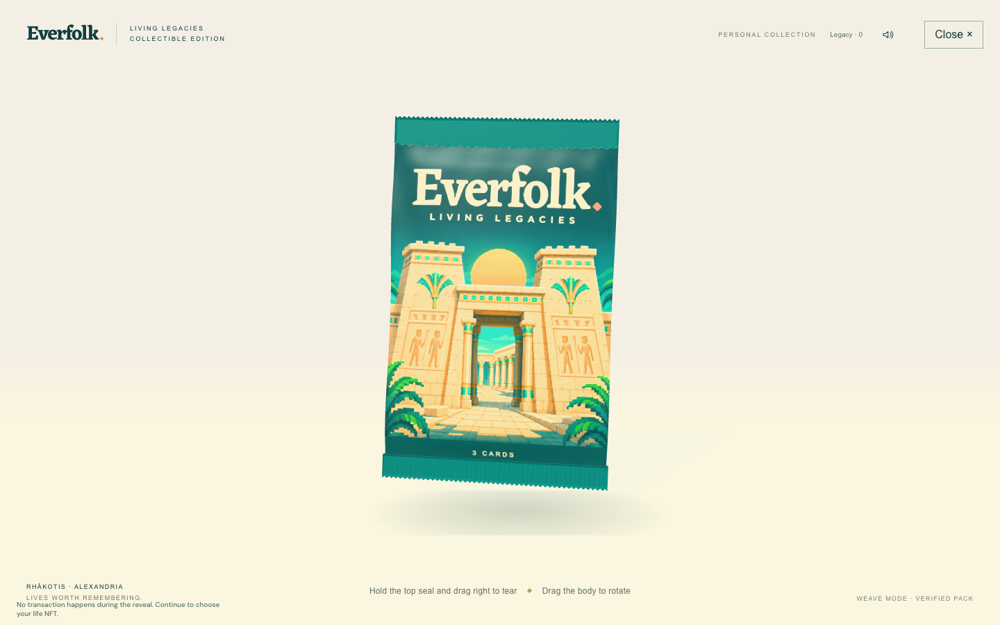
      </a>
      <p align="center"><b>Living-Legacies Pack Preview (<code>/test/weave/pack</code>)</b><br><sub>Current Weave packs contain <b>up to five distinct earned cards</b>, ordered by rarity. Age milestones alone add no cards. Opening has no mint fee; NEAR transaction gas still applies.</sub></p>
    </td>
    <td width="50%" valign="top">
      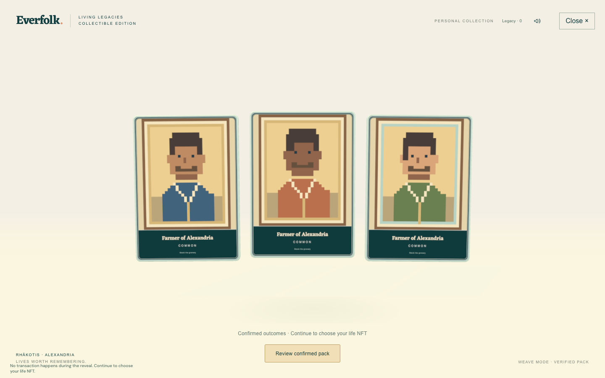
      <p align="center"><b>Earned Card Reveal &amp; Slot Pick</b><br><sub>Inspect the stored candidates in 3D WebGL, then choose one card to mint. The contract enforces its edition limit and records its title, art, rarity and serial.</sub></p>
    </td>
  </tr>
</table>

The updated opening lets you rotate the foil pack, drag its top seal left or right to tear it, and inspect revealed cards in 3D. Keyboard opening uses **hold Space + repeated Left or Right Arrow**; double-click a revealed card for a close look. Legendary cards have dedicated lighting and rainbow effects, with reduced-motion handling and a fallback when WebGL is unavailable.

Try the standalone [pack showcase](https://beta.everfolk.life/showcase/pack) for repeatable five-card preview draws with at least one Legendary. Its random previews are separate from the cards a played life earns and from contract edition supply.

---

## NFTs & Historical Collectibles

### Historical Figures (Earned on Their Paths &middot; Legendary 10 / Epic 25 Copies)

A figure card requires completed contributions and a separately assessed capstone, with the skills, materials and chronology specified by its path. Authored direct encounters, Euclid's teaching circle and later tradition routes have distinct wording and requirements. Meeting someone or reaching a high skill score alone awards no figure card. Each Legendary design is limited to 10 copies; each Epic design to 25. See [Historical Figure Paths](design/figure-paths.md).

<table>
  <tr>
    <td width="25%" align="center" valign="top">
      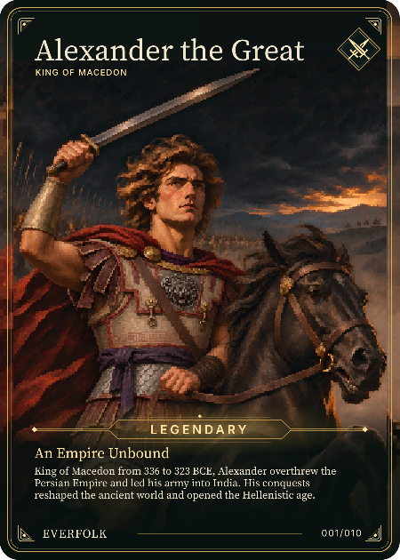<br>
      <b>Alexander the Great</b><br>
      <sub><code>alexander</code> &middot; Legendary &middot; 10 copies</sub><br><br>
      <sub><b>Path:</b> Meet him in Egypt 332–331 BCE, contribute to campaign logistics, then win the one-shot decisive campaign before 323 BCE; a lost campaign earns no figure card.</sub><br>
      <sub><b>Deeds:</b> <code>alexander.levy</code> &middot; <code>alexander.found</code></sub>
    </td>
    <td width="25%" align="center" valign="top">
      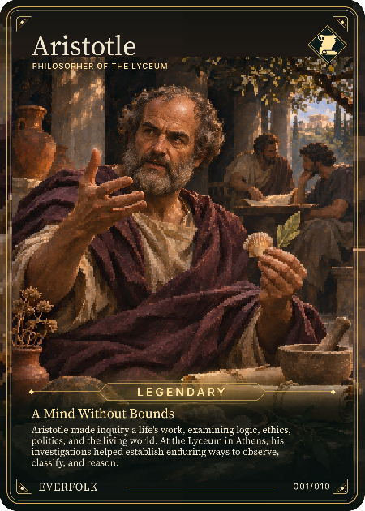<br>
      <b>Aristotle</b><br>
      <sub><code>aristotle</code> &middot; Legendary &middot; 10 copies</sub><br><br>
      <sub><b>Path:</b> Join the Lyceum (335–323 BCE), contribute independent research, then complete an independently checked body of inquiry and teaching.</sub><br>
      <sub><b>Deeds:</b> <code>aristotle.lyceum</code> &middot; <code>aristotle.tutor-court</code></sub>
    </td>
    <td width="25%" align="center" valign="top">
      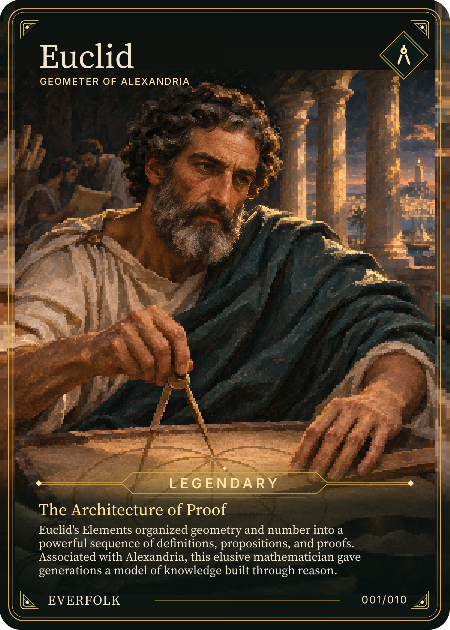<br>
      <b>Euclid</b><br>
      <sub><code>euclid</code> &middot; Legendary &middot; 10 copies</sub><br><br>
      <sub><b>Path:</b> Join the geometrical teaching circle in Alexandria (from about 300 BCE), check and organise proofs, then complete a reviewed deductive collection.</sub><br>
      <sub><b>Deeds:</b> <code>euclid.school</code> &middot; <code>euclid.museum</code></sub>
    </td>
    <td width="25%" align="center" valign="top">
      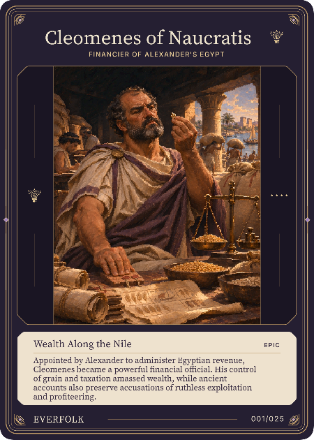<br>
      <b>Cleomenes</b><br>
      <sub><code>cleomenes</code> &middot; Epic &middot; 25 copies</sub><br><br>
      <sub><b>Path:</b> Work in revenue administration (332–323 BCE): accounts, grain delivery and oversight, then an audited grain and revenue programme.</sub><br>
      <sub><b>Deeds:</b> <code>cleomenes.corner-grain</code> &middot; <code>cleomenes.granaries</code></sub>
    </td>
  </tr>
</table>

<p align="center">
  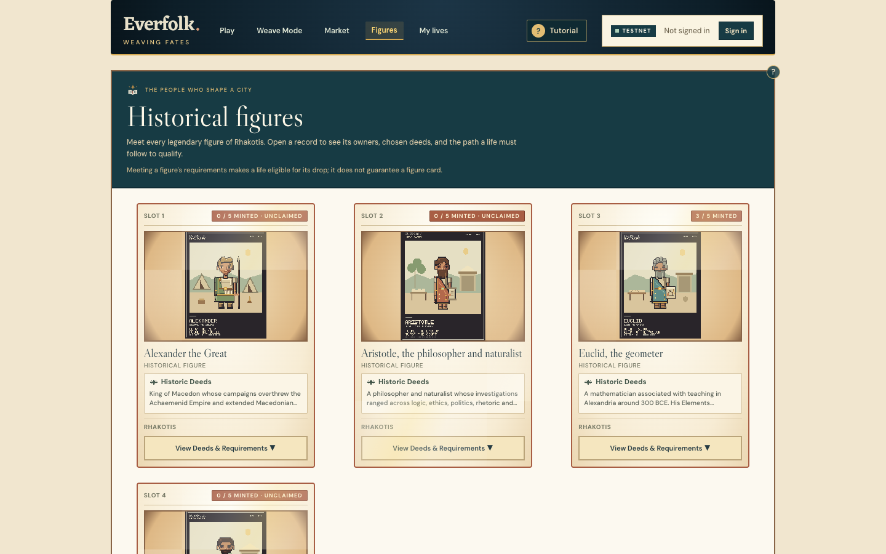
</p>

The full playable roster also includes **Lysippos, Pytheas of Massalia, Menander, Demetrius the Besieger, Theophrastus, Zeno of Citium and Ptolemy I Soter**. Each has its own contribution work, resource costs and capstone. Alexander's decisive campaign and the Legendary promotions for Demetrius, Ptolemy and Zeno use one-shot outcomes. A failed outcome preserves earlier contribution progress without granting the final title; Demetrius's successful capture of Rhodes is explicitly alternate history.

The [card gallery](https://beta.everfolk.life/cards) contains artwork for 13 figures, including **Nearchus** and **Eumenes of Cardia** beyond the eleven current playable paths. Each illustrated figure has a principal design and four contributor ranks in male and female variants, making 117 gallery designs in total.

### Earned Cards, Career Groups & Deeds

Current Weave NFTs are **earned, never rolled** ([eligibility rules](chain/earned-cards.ts)). A finished life can mint one card selected from its earned v14 pack candidates:

- **Figure card:** the figure's own card, for completing its contribution ladder and the separately assessed capstone. Alexander, Aristotle, Euclid, Lysippos and Menander are Legendary. Demetrius, Ptolemy and Zeno reach Legendary only through a one-shot promotion (Rhodes captured in alternate history, the dynasty founded, an independent Stoa). The rest stay Epic.
- **Contributor card:** the player's own rank on that path (e.g. *Campaign Soldier* → *Trusted Commander*), in the played character's recorded sex. It is Epic at most, and Rare at most below an Epic figure.
- **No completed path work, no card:** a life with no earned figure or contributor cards has no mintable pack. Age milestones alone grant no cards, and life-stage NFT minting is disabled for earned-card lives.

Every minted NFT names its card on chain (`card_id`, title, absolute image, serial such as `003/025`, attributes). Its **deed** is chosen by career group and drives the on-chain draw categories:

| Career Group | Draw Category | Selectable On-Chain Deeds (`chain/catalog/contract-catalog.json`) |
|---|---|---|
| **Letters** | `education` | `letters.teach` &middot; `letters.lend-books` |
| **Military** | `war`, `road` | `military.mentor` &middot; `military.warn-levy` &middot; `military.guard-road` |
| **Commerce** | `money` | `commerce.credit` &middot; `commerce.hire` |
| **Craft** | `work` | `craft.apprentice` &middot; `craft.commission` |
| **Sky** | `fate` | `sky.omen` &middot; `sky.warn-year` |
| **Performance** | `spirit` | `performance.lift` &middot; `performance.lend-hand` |
| **Farming** | `harvest` | `farming.stock-granary` &middot; `farming.share-seed` |

Owners can switch an NFT's active deed via `set_action` (except the special-purpose `alexandria-demo-2` demo world when testing isolated granary/convoy triggers), list or buy via `list` / `buy`, and inspect on-chain impact with `sources_of` and `children_of`. The [contract source](contract/src) defines the current earned-card methods; the [contract guide](contract/README.md) also documents retained legacy interfaces.

---

## Smart Contracts & Protocol Parameters

### NEAR Testnet Deployments

| Deployment | Account ID | Explorer | Purpose &amp; Live Rules |
|---|---|---|---|
| **Current Earned-Card Contract** | `everfolk-cards-11140224.testnet` | [NearBlocks &nearr;](https://testnet.nearblocks.io/address/everfolk-cards-11140224.testnet) | Configured by `dev`: earned-card packs, free opening and payment at mint (`mint_terms.pack_version = 2`). Supports `alexandria-weave-1` and `alexandria-npc-1`; NFTs carry card identity, title, image, serial and attributes. |
| **Previous Contract** | `everfolk-albums-11121956.testnet` | [NearBlocks &nearr;](https://testnet.nearblocks.io/address/everfolk-albums-11121956.testnet) | Pay-at-opening packs without rarity caps. Existing tokens remain readable on-chain. |
| **Legacy v1 Contract** | `everfolk-lives-11101338.testnet` | [NearBlocks &nearr;](https://testnet.nearblocks.io/address/everfolk-lives-11101338.testnet) | Initial v1 deployment (`1 NEAR` mint fee, `alexandria-ranked-1`, pre-stage-albums). Existing tokens remain readable on-chain. |
| **Rehearsal / Demo Contract** | `demo.genesis-1794297139-6.testnet` | [NearBlocks &nearr;](https://testnet.nearblocks.io/address/demo.genesis-1794297139-6.testnet) | Isolated demonstration deployment (`100%` qualified figure drop, `0` nobody draw weight, `0` abandon cooldown) used for walkthrough recording. |

- **Standards Implemented:** `NEP-171` (NFT Core), `NEP-177` (Metadata), `NEP-178` (Approvals), `NEP-181` (Enumeration), `NEP-199` (Payouts).
- **Runtime Configuration:** [`GET /api/ranked/config`](server/ranked/routes.ts) reports the configured verifier public key, contract and RPC. Read `mint_terms`, `get_params` and `edition_supply` for the selected contract's current fees and availability; older deployments retain their own rules.
- **Default Testnet RPC:** `https://test.rpc.fastnear.com` (overridable via `NEAR_RPC_URL`).

### On-Chain Economics, Rarity & Protocol Bounds

<table>
  <tr>
    <td width="50%" valign="top">

**Fee &amp; Royalty Schedule (`everfolk-cards-11140224.testnet`)**

| Parameter | Value | Description |
|---|---|---|
| `mint_fee` | `0.001 NEAR` default | Paid when the chosen pack card is minted; opening has no mint fee (`10^21` yoctoNEAR). Transaction gas is separate. |
| Card limits | `10 / 25 / 100` | Legendary / Epic / Rare copies per card design; Common and Uncommon unlimited; an earned card whose design is sold out cannot be minted |
| `source_mint_share_bps` | `5000` (`50%`) | Mint fee share distributed by impact to upstream sources |
| `royalty_sources_bps` | `500` (`5%`) | Secondary sale royalty paid proportionally to sources |
| `royalty_treasury_bps` | `500` (`5%`) | Secondary sale royalty routed to protocol treasury (`10%` total) |
| `nobody_weight_bps` | `5000` (`50%`) | Baseline draw weight allocated to uninfluenced turns |
| `abandon_cooldown_ms` | `600000` (`10 min`) | Cooldown after abandoning an active life |

  </td>
  <td width="50%" valign="top">

**Gas Floors, Rarity Scaling &amp; Storage Bounds**

| Constraint | Value | Notes |
|---|---|---|
| `open_mint_pack` Gas | `150 Tgas` | Holds the earned cards before the reveal choice |
| `draw_npc` Gas | `100 Tgas` | Samples Affection-weighted token from category pool |
| Per-Life Draw / Checkpoint Cap | `128` / `128` | Max recorded NPC draws and 5-year checkpoints |
| Pool / Source Cap | `1000` / `64` | Max pooled NPCs per category; max upstream sources per NFT |
| Rarity Impact Multiplier | `1.0x` – `3.0x` | Common `10000`, Uncommon `12500`, Rare `15000`, Epic `20000`, Legendary `30000` bps |

  </td>
  </tr>
</table>

<details>
<summary><strong>Smart Contract Methods, Auth &amp; Play-Key Model, and Honest Limits</strong></summary>

#### Current Contract Interface ([source](contract/src))

| Area | Methods |
|---|---|
| **Lives** | `start_life`, `abandon_life`, `draw_npc`, `checkpoint`, `get_life`, `active_life_of` |
| **Packs &amp; Mint** | `mint_terms`, `open_mint_pack` (earned-card evidence), `get_mint_pack`, `choose_mint_slot` (payable), `mint_result`, `set_action`, `edition_supply`, `rarity_supply`, `figure_supply` |
| **Earnings &amp; Graph** | `withdraw`, `balance_of`, `sources_of`, `children_of`, `token_stats` |
| **Market (`NEP-199`)** | `list`, `unlist`, `buy` (payable), `listing`, `listings`, `nft_payout`, `nft_transfer_payout` |
| **Pools &amp; Admin** | `active_pool`, `figure_copies`, `set_verifier_keys`, `set_catalog`, `set_card_art`, `set_params`, `set_world_versions` |

#### Dual Authentication (`Weave Mode`)

- **NEAR Wallet Connect:** Standard wallet signing via `@hot-labs/near-connect`.
- **Privy Email + Play Key:** Players without an external wallet can sign in via email (`@privy-io/react-auth`), provisioned with a scoped testnet play key backed by the configured funder account (`EVERFOLK_FUNDER_ACCOUNT_ID`).

#### Honest Limits

- **Randomness:** Birth seeds and cross-life draws use NEAR block randomness (`env::random_seed()`). Earned-card eligibility comes from replayed achievements; the current figure-path pack does not roll random rewards.
- **Verifier Trust Model:** Currently operated as a signed Edge Worker service (`RANKED_VERIFIER_SECRET`) behind a modular `LifeVerifier` interface so a TEE verifier can swap in without changing contract verification.
- **External vs. In-Game Marketplaces:** External `NEP-199` marketplaces receive payout maps truncated to their `max_len_payout` (unfitted remainder routes to treasury); Everfolk's native market pays every source up to the 64-source cap.

</details>

---

## Architecture & System Design

### 1. System Topology & Runtime Boundaries

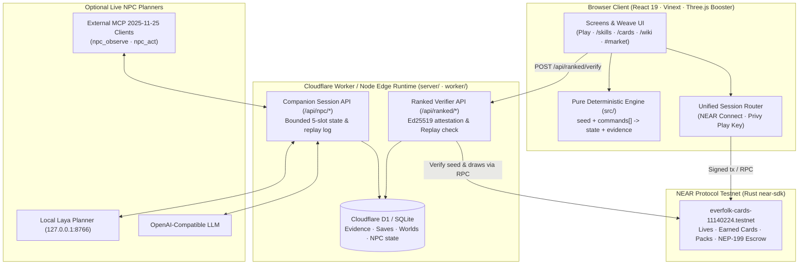

### 2. Ranked Proof-Before-Mint Sequence

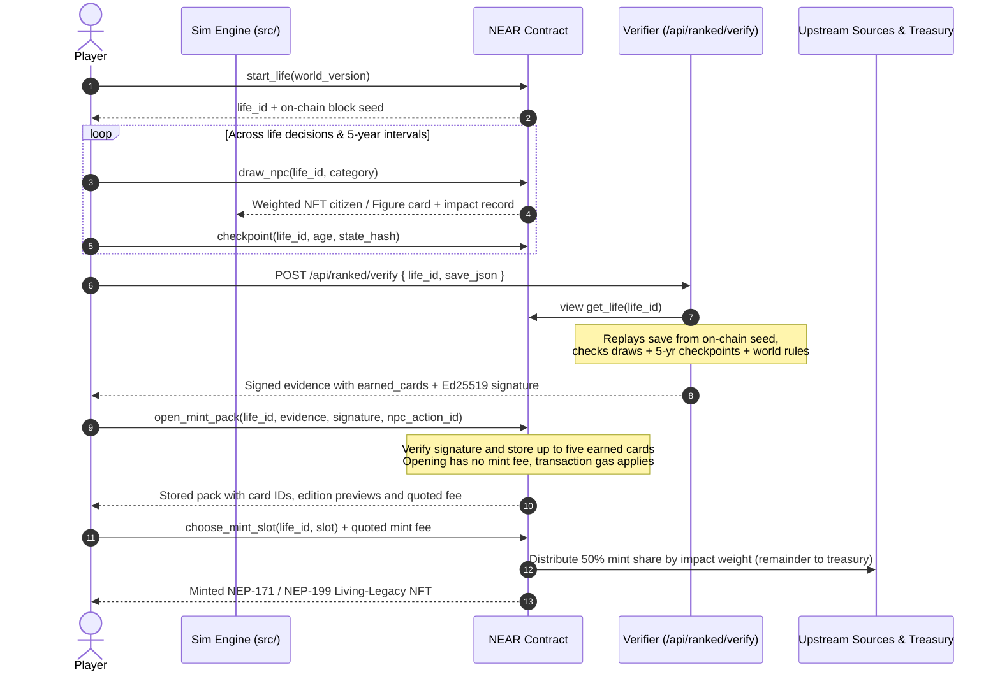

### 3. Source Influence & `NEP-199` Royalty Flow

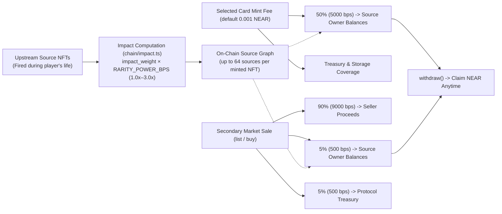

### 4. Codebase Layer Ownership

Strict unidirectional imports across modules are mechanically verified in CI by [`pnpm check:structure`](scripts/check-structure.mjs) and detailed in [ARCHITECTURE.md](ARCHITECTURE.md):

| Directory | Responsibility &amp; Allowed Dependencies |
|---|---|
| [`src/`](src) | Pure headless deterministic simulation (calendar, RNG, stats, skills, family, commerce, war, command reducer, serialization). Zero React, browser DOM, or server dependencies. |
| [`chain/`](chain) | Shared rules and catalogs, current Weave world, earned-card eligibility, impact math and replay verification used by client and verifier. Retained legacy worlds keep their earlier pack rules. |
| [`client/`](client) | UI layer organized strictly as `types` &rarr; `lib` &rarr; `models` &rarr; `state` &rarr; `queries` &rarr; `mutations` &rarr; `hooks` &rarr; `components` &rarr; `screens`, plus `chain/` Weave screens and `demo/`. |
| [`contract/`](contract/README.md) | Rust `near-sdk` workspace implementing lives, earned-card packs, per-design editions, market escrow and NEAR NFT standards, plus retained legacy mint interfaces. |
| [`server/`](server) &middot; [`db/`](db) &middot; [`worker/`](worker) | Vinext route handlers, D1/SQLite Drizzle schema, Ed25519 `LifeVerifier`, rate limits, and standalone/ranked `/npc` companion services. |
| [`worlds/`](worlds) &middot; [`scripts/`](scripts) | Versioned immutable world JSON packs (retaining historical saves) and CLI generators/evaluators (`ranked:world`, `demo:world`, skill cohort evaluation). |

---

## Skill Atlas & Economy

Everfolk models livelihoods through connected prerequisites, proficiency gates, and **demonstrated-work proof** rather than abstract XP bars:

- **74-node Skill Atlas (`/skills`):** **Physique**, **Handmade**, **Knowledge** and **Trade** span ten depth tiers. The interactive map runs left to right on a dark background; each node explains prerequisites, required proof and practical rewards. Military crossovers connect physical conditioning and inquiry to command ([progression guide](guide/SKILL_CROSSOVERS.md)).
- **Practice with proof:** Learn through qualified actions and demonstrated work. Newly learned skills appear in the notification feed and are marked in the skill trees. Historical projects consume real materials, school or workshop funds and annual actions; completed contributions and capstones retain their provenance in the life record.
- **Current household resources (`alexandria-lives-11`):** Working households begin with modest reserves, while merchant and estate backgrounds have different resources. Grain, flax, linen, animals, supplies and market depth connect production, food security and trade. The trade preview explains quantity-dependent prices and the total before confirmation.
- **Retained benchmark (`alexandria-lives-8`):** The [800-life seeded evaluation](guide/SKILL_TREE.md) reported depth-10 specialization rates of **55.0%–64.0%** under its disclosed policies. Those figures describe that revision and evaluation. Current historical-card completion rates require separate measurement.

<p align="center">
  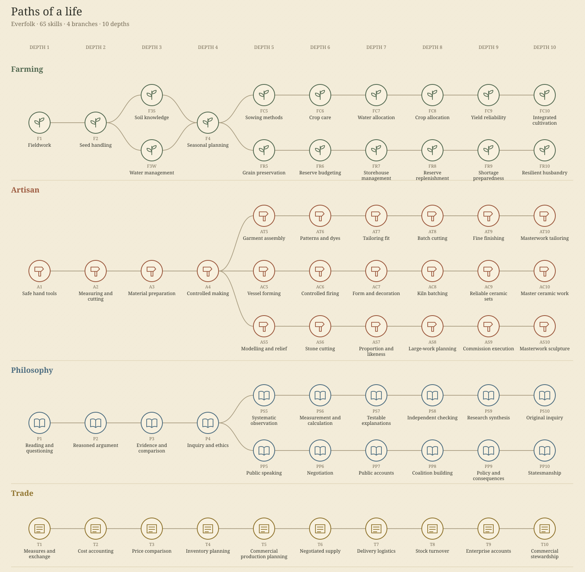
</p>

---

## NPC Companions & Agent Runtime

Visit [`/npc`](https://everfolk.life/npc) to run an online life shared with **five persistent companion slots** (2 caregivers, mentor, merchant, and peer) operating on real household and market accounts:

- **Deterministic Fallback + Live AI:** Rules keep gameplay running cleanly even without an external LLM. Connect **Local Laya** (`127.0.0.1:8766`, up to `1000` calls/life &amp; `5000`/day) for fast local action selection, or any **OpenAI-compatible endpoint** (`100` calls/session, `200`/day) for rich dialogue.
- **External MCP (`2025-11-25`) &amp; REST Control:** External agents can inspect state and act directly via `npc_observe`, `npc_actions`, `npc_act`, and `npc_events` or `/api/npc/sessions/:id/*`.
- **Fair Play Separation:** Standalone `/npc` sessions never mint NFTs; Weave Mode `alexandria-npc-1` gates ranked reward verification with `requireLiveProviderForRewards` and logs provider outages cleanly (`30s` cooldown). See [NPC Setup &amp; MCP Guide](guide/NPC_AGENTS.md) and [Judge Readiness](guide/JUDGE_READINESS.md).

---

## Quickstart

### Prerequisites

- **Node.js `24+`** &amp; **pnpm `11.25.0`**
- **Rust + `cargo-near`** (only needed to rebuild or unit-test the NEAR smart contract)

### 1. Run Locally (Browser Game + Worker SSR)

```sh
pnpm install --frozen-lockfile
pnpm dev
```

Free play works out of the box with no account or secrets (browser storage and JSON import/export). Local Weave verification needs `RANKED_VERIFIER_SECRET=<64-hex>` in an ignored `.dev.vars`, with the matching public key registered on the selected testnet contract. Configure the contract and optional sign-in/funder settings using [.env.production.example](.env.production.example) and the [contract guide](contract/README.md).

For an isolated browser preview of current historical lives, run `node scripts/preview-lives.mjs --world-pack worlds/demo/alexandria-lives-11.json` and open `http://localhost:5175/`. The bundled world works without a database. `/test-aristocrat` and `/test-royalty` open class scenarios without writing personal saves. The regular `pnpm dev` server also provides `/loading-preview` to inspect the loading screen.

On the regular development server, `/showcase/pack` opens the repeatable card reveal and `/showcase/royalty` opens the six household scenarios. These showcases can be explored without changing a personal life or minting an NFT.

Editable artwork and authoring libraries live in private VPS storage outside this repository. Normal development, builds and CI use delivered assets and compact retained metadata; they do not need the full source archive. See [Artwork Storage](guide/artwork-storage.md) for the pinned releases and explicit authoring-source retrieval.

### 2. Run with Docker (Production Bundle on `workerd`)

```sh
cp .env.production.example .env.production   # configure verifier key, funder, Privy ID
docker compose up -d --build                 # serves http://localhost:8787 with persistent /data D1 volume
docker compose logs -f everfolk
```

Put a TLS reverse proxy (Caddy or nginx) in front of port `8787` and add the public origin to your Privy app's allowed origins.

### 3. Verification, Builds &amp; Contract Tests

<details>
<summary><strong>Development Commands, Contract Testing &amp; Testnet Deployment Scripts</strong></summary>

```sh
# Workspace validation and regression suites
pnpm check              # TypeScript typecheck + English-only check + architecture boundaries
pnpm test:dev           # Focused development safety suite used by dev CI
pnpm test               # Full default regression suite used by main CI
pnpm build              # Checks, then production Vinext + Cloudflare Worker bundle
pnpm build:app          # Build an already-checked checkout (the CI build step)
pnpm preview            # Preview production build locally

# Specialist verification when the changed inputs require it
pnpm test:art           # Delivered assets, art tooling and character creator
pnpm test:audit         # Exhaustive balance cohorts and historical-content audits
```

```sh
# NEAR Smart Contract (Rust unit suite inside contract/)
cd contract
cargo test --locked --lib
cargo near build non-reproducible-wasm
```

```sh
# Testnet deployment & smoke verification helpers
CONTRACT_ID=everfolk-albums-demo.testnet VERIFIER_PUBLIC_KEY=ed25519:... scripts/ranked/deploy-contract.sh
CONTRACT_ID=everfolk-albums-demo.testnet KEEP_VERIFIER_KEY=ed25519:... scripts/ranked/smoke.sh
```

```sh
# Regenerate content from its owning generators; retain previous immutable packs for existing saves
pnpm content           # Classic Alexandria content
pnpm resources:world   # Household-resource worlds, including current alexandria-lives-11 births
```

</details>

CI selects checks from the changed paths. `dev` uses `test:dev` with a three-minute verification budget; `main` uses the full default regression suite. Art and contract jobs run when their inputs change. Documentation-only changes skip application jobs. Manual runs can request full regressions and exhaustive audits. See [Contributing](CONTRIBUTING.md) for the complete workflow.

---

## Development & Deployment

| Environment | Branch | Address | Data |
|---|---|---|---|
| Development beta | `dev` | [beta.everfolk.life](https://beta.everfolk.life) | Separate beta D1 volume and origin-local browser saves |
| Production | `main` | [everfolk.life](https://everfolk.life) | Existing production D1 volume and origin-local browser saves |

The VPS deployment runner tracks both branch heads, builds an immutable application image, and replaces that environment after checks pass. It records the package version, branch and full commit in `/build-info.json`. The timer checks for changes about every two minutes after the previous run completes; build and startup time add to that interval. After beta acceptance, merging `dev` into `main` makes the change eligible for production deployment.

Beta and production use separate databases but can share testnet contracts, wallets and external-service quotas. Both use a pinned public media release. The [deployment guide](tools/app-vps/README.md) covers installation, health checks, data backups and rollback; [deployment records](tools/app-vps/DEPLOYMENT.md) describe the configured environments.

Application source, delivered media and editable artwork have separate storage roles. Normal builds use repository delivery assets and retained metadata. Large authoring libraries are retrieved explicitly through `EVERFOLK_ARTWORK_DIR`. A public `VITE_EVERFOLK_ASSET_BASE_URL` can select an immutable CDN release; image requests retry their original local file if delivery fails. See [Artwork Storage](guide/artwork-storage.md) and [Artwork Delivery](guide/artwork-delivery.md).

---

## Classic Alexandria households and portraits

The retained classic world revisions include the household systems below. Their birth probabilities, council rules and bulk-contract limits belong to those packs; current historical-lives births and existing saves use their own revision's rules.

Classic Alexandria lives record named parents and grandparents with their household backgrounds and occupations. Living grandparents are rare: 10% of new households start with one. Open Family for a table of living relatives, your spouse and children, with deceased relatives kept under Remembered family. Relationships lists friends, business partners, teachers, disciples, enemies and romantic relationships as they form, alongside backgrounds, work and recorded bonds.

Classic Alexandria lives offer work shaped by their household background, with farming as an optional livelihood. Independent material trades use purchased supplies to produce goods for sale. Place bulk market contracts during the year: cash or stock is reserved immediately, and deliveries and sale receipts settle at the next year end. Quotes respond to events reported in the life. Choosing the Trading focus puts ordinary work aside; repeated years of completed sales can open the trader occupation.

The market shows resources useful to your current work and background, goods you own or have ordered, and supplies for tasks you can take. Traders, shopkeepers, merchants, estate stewards and quartermasters can browse the full catalogue with search and category filters because their work involves broad purchasing or resale. Other occupations keep a focused selection. Starting-resource displays focus on your household's rolls and possessions.

In new classic Alexandria lives, royal births follow a separate household council path. Guide the house treasury, court influence, household stability, security and succession, with private lessons from age eight and council responsibilities from sixteen. Household staff handle trade and ordinary work; royal decisions concern envoys, guards, petitions, estate obligations and family agreements. Personal health, family and historical changes still shape the life. This fictional minor royal branch does not automatically inherit Egypt's throne. Earlier saves retain their original rules.

Aristocrats born into the landowning estate household manage an Estate council: invest in land and storage, settle tenant agreements, maintain local patronage, collect rents and plan the family's inheritance. Estate prosperity and tenant loyalty affect annual returns. Their staff handle ordinary trade and paid work. New lives have a 6% chance of an aristocratic birth and a 2% chance of a royal birth; these are authored game probabilities, increased from 3% and 1%. Begun lives keep their original world revision.

The `/test-aristocrat` and `/test-royalty` previews use the regular life screen, year controls, event feed and management dialog, with a small preset selector. Normal play at the preview root uses browser saves.

Royal and aristocratic births receive a congratulations popup after the starting-stat reveal and **Begin life**. A skippable four-step tour introduces their treasury, household conditions, yearly council decisions and earned titles; time waits while the tour is open. **Household guide** in the character panel reopens it. Both class test pages show the introduction and include **Try birth welcome** to test the complete newborn reveal and tutorial without personal saves.

Each council contains three earned title paths. Royal households pursue Ambassador of the House, Guardian of the House or Unifier of the House; estate households pursue Restorer of the Estate, Trusted Patron or Keeper of the Family Lands. A path requires an actual council service, three accepted duties across several years, maintained household conditions and a final recognition action. The two middle projects can fail, spend their budget and require two years before a retry. Recognition adds 5 drachmas to the household treasury each year. These are fictional household distinctions. They also develop practical skills; treasury-funded lessons and historical service opportunities let either class pursue the existing historical titles within their original dates and recognition odds.

New lives limit ordinary household contracts to 50 units per order and 100 total units per year. Roles with full market access can commit 100 units per order and 300 per year. Purchases and sales share that yearly allowance, including orders split across different goods. Cancelling a contract releases its allowance; completing the year renews it. At most eight contracts may be pending.

The bundled classic Alexandria world groups eight earned historical title paths and their milestone sub-cards, including Right Hand of Alexander, General of Alexander, and scholarly work associated with Aristotle, Euclid and Theophrastus. Scholarly paths use independent study and reviewed work, without requiring personal lessons or teaching-window deadlines. Complete a path's tasks and recognition review to collect its sub-cards under your character's name. Works & deeds shows preparation and progress; the collection can filter by historical figure.

The portrait libraries retain their source manifests, QA records and dependencies. The application delivers 240 v3 portrait PNGs. Begun lives retain their exact world revision.

---

## Guides & Documentation

| Document | Topics Covered |
|---|---|
| [Project Report](guide/REPORT.md) | Protocol design rationale, 4 on-chain mechanics, figure calibration &amp; honest limits |
| [How to Play (Tutorial)](guide/TUTORIAL.md) | Step-by-step Alexandria life walkthrough &amp; UI controls |
| [Historical Figure Paths](design/figure-paths.md) | Eleven contribution ladders, capstones, chronology, resource requirements and conditional Legendary outcomes |
| [Example Euclid Life (#12)](guide/EXAMPLE_LIFE.md) | Earlier testnet playthrough; documents the legacy figure-mint rules used by that life |
| [Skill Tree &amp; Benchmarks](guide/SKILL_TREE.md) | 74-node progression model &amp; 800-life seeded mastery data |
| [Military Crossovers](guide/SKILL_CROSSOVERS.md) | Requirements joining Physique and Knowledge into military command |
| [NPC Companions &amp; MCP](guide/NPC_AGENTS.md) | Local Laya, OpenAI-compatible setup, REST API &amp; MCP tool specification |
| [Judge Readiness](guide/JUDGE_READINESS.md) | Verification boundaries between standalone `/npc` preview and Weave Mode |
| [Smart Contract Reference](contract/README.md) | Method catalog, gas floors, storage economics &amp; failure recovery |
| [Branch Deployment](tools/app-vps/README.md) | Beta/production branch mapping, immutable builds, health checks, backups and rollback |
| [Artwork Storage](guide/artwork-storage.md) &middot; [Artwork Delivery](guide/artwork-delivery.md) | Private authoring archives, public media releases, CDN configuration and local fallback |
| [Card Source Metadata](assets/source/cards/README.md) &middot; [Banner Provenance](assets/source/banners/README.md) | Reviewed card identities, authoring-source requirements and structural/hash evidence for delivered banners |
| [Architecture &amp; Contributing](ARCHITECTURE.md) &middot; [CONTRIBUTING.md](CONTRIBUTING.md) &middot; [ROADMAP.md](ROADMAP.md) | Module dependencies, PR-free branch rules &amp; development phases |

---

## Assets, Typography & Attributions

| Delivered Library | Current Contents | Inventory / Provenance |
|---|---|---|
| **v14 cards** | 117 designs plus 19 principal-card rarity variants; 487 lossless WebP files, including full cards, thumbnails, footerless frames and portrait crops. Full cards are 900×1260; thumbnails are 450×630. | [Runtime registry](client/models/card-art-registry.json) &middot; [Delivery manifest](public/assets/cards/collection-v14/manifest.json) |
| **v3 portraits** | 240 PNGs at 384×480, covering six identities, six visual stages and the applicable livelihood and household wardrobes. | [Delivery manifest](public/assets/portraits/ordinary-v3/manifest.json) &middot; [Reviewed source metadata](assets/source/portraits/ordinary-v3/reviewed-manifest.json) |
| **Concept 1 scene artwork** | 24 PNG scene plates and 1,296 transparent actor sprites at 480×224, covering six stages, four career roles and household appearance variants. | [Scene manifest](public/assets/pixel/banners-concept1/manifest.json) &middot; [Pinned scene media release](assets/storage/scene-media-lock.json) |
| **SVG scene fallbacks** | 24 scene plates and 864 actor poses in SVG, on a shared 240×112 canvas. Native masters retain separate editable layers. | [Banner manifest](public/assets/pixel/banners/manifest.json) &middot; [Native provenance](assets/source/banners/native-provenance.json) |
| **Illustrated play guide** | Six WebP screenshots: time controls, focus, yearly actions, fields, market and life record. | [Delivered screenshots](public/assets/how-to-play) &middot; [Guide content and examples](client/models/how-to-play.ts) |
| **3D booster pack** | Temple-print pack texture, wordmark and bundled Eczar font, used by the foil-opening and card-inspection scene. | [Pack assets](public/assets/booster) &middot; [Reveal runtime](client/lib/booster/runtime.mjs) |
| **Skill Atlas** | The 74-node vector map and the bundled open-source skill-icon library. | [Atlas SVG](public/assets/skills/skill-atlas.svg) &middot; [Icon attribution](public/assets/skill-icons/open-source-v3/ATTRIBUTION.md) |
| **Audio** | Eight delivered audio files, including the selected 600-second *Macedonian Garden* loop, retained music tracks and a UI click. | [Checksums and source records](public/assets/audio/manifest.json) &middot; [Credits and redistribution notices](public/assets/audio/ATTRIBUTION.md) &middot; [License texts](public/assets/audio/LICENSES.txt) |

- **Card integration and authoring:** The same reviewed art appears in earned collections, market cards, mint/reveal screens and 3D pack reviews. Recorded NFT rarity and serials stay authoritative; preview serials are examples. `pnpm art:cards` rebuilds delivery from the reviewed native library using the locally installed VectorCraft CLI; `pnpm portraits:sync` rebuilds portrait delivery. Both require the optional authoring archive selected with `EVERFOLK_ARTWORK_DIR`. Full SVG/native masters and verification are retained in the private [artwork source archive](guide/artwork-storage.md); compact catalogues, reviewed metadata and banner provenance remain in `assets/source/`.
- **Card symbols:** Twelve professionally drawn Game-icons.net designs by Lorc/Delapouite (CC BY 3.0) and Google's drafting-compass symbol (Apache 2.0) replace the original drawn placeholders. Author/source links, unchanged originals and licenses are bundled at [`icon-credits.html`](public/assets/cards/collection-v14/icon-credits.html). Inter is bundled under the SIL Open Font License for the live edition text. Illustration originals and PixelOE QA remain in the private source archive under `cards/figure-inner-art-v14/`.
- **Brand System (Printed Folktale):** Bundles `Eczar 600` wordmarks/headings and `DM Sans 500` narrative typography under the SIL Open Font License ([`public/fonts/`](public/fonts), the private [branding source archive](guide/artwork-storage.md)).
- **Other artwork and historical context:** Earlier pixel scenes, 480×640 figure art and paper cutout plates remain in `public/assets/` alongside the current libraries. Historical contexts are sourced, while individual characters, prices, probabilities and scenes are authored fiction and illustrations. Per-asset source and license records govern reuse of bundled media.
