<div align="center">

<picture>
  <source media="(prefers-color-scheme: dark)" srcset="public/assets/branding/everfolk-wordmark-cream@2x.png">
  <source media="(prefers-color-scheme: light)" srcset="public/assets/branding/everfolk-wordmark-ink@2x.png">
  
</picture>

### Deterministic Ancient Alexandria Life Simulation & Living-Legacy NFT Protocol on NEAR

<p>
  <a href="https://everfolk.life"></a>
  <a href="https://everfolk.life/test/weave/granary"></a>
  <a href="https://everfolk.life/#market"></a>
  <a href="https://everfolk.life/skills"></a>
  <a href="https://testnet.nearblocks.io/address/everfolk-albums-11121956.testnet"></a>
</p>

<p>
  <a href="https://github.com/kvnhoag/everfolk/actions/workflows/ci.yml"></a>
  
  
  
  
</p>

<p>
  <a href="#product-showcase">Showcase</a> &middot;
  <a href="#how-living-legacies-work">How It Works</a> &middot;
  <a href="#nfts--historical-collectibles">NFTs &amp; Figures</a> &middot;
  <a href="#smart-contracts--protocol-parameters">Contracts &amp; Tokenomics</a> &middot;
  <a href="#architecture--system-design">Architecture</a> &middot;
  <a href="#skill-atlas--economy">Skill Atlas</a> &middot;
  <a href="#npc-companions--agent-runtime">NPC Agents</a> &middot;
  <a href="#quickstart">Quickstart</a>
</p>

</div>

---

**Everfolk** is a deterministic browser-based life simulation set in Ptolemaic Alexandria (350–300 BCE), paired with an on-chain **Living-Legacy NFT protocol** on NEAR.

In **Free Play**, every life runs locally from a seed and command log with zero account setup. In **Weave Mode**, NEAR coordinates four structural mechanics that cannot live off-chain alone:
1. **Verifiable Genesis:** `start_life` assigns each life's seed from NEAR validator randomness so no player can farm ideal births.
2. **Cross-Life Interference:** At pivotal life choices, the contract draws living citizen NFTs (weighted by Affection, scaled by Rarity) and historical figures (Alexander, Aristotle, Euclid, Cleomenes) whose deeds alter your fate.
3. **Proof-Before-Mint Verification:** A deterministic verifier replays your save against the on-chain seed, 5-year checkpoints, and drawn tokens, issuing an Ed25519 attestation checked on-chain before minting a 1–5 card booster pack.
4. **Influence Royalty Graph (`NEP-199`):** Every prior NFT whose deed triggered in your life becomes a **source** of your minted NFT — automatically splitting **50% of mint fees** and **5% of secondary sales** to upstream owners in proportion to life impact.

---

## Product Showcase

<a href="https://everfolk.life">
  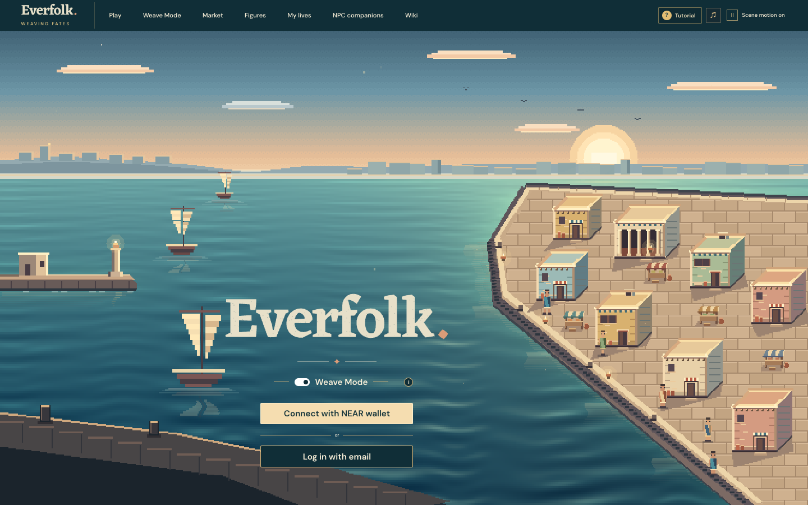
</a>

<table>
  <tr>
    <td width="50%" valign="top">
      <a href="https://everfolk.life/test/weave/granary">
        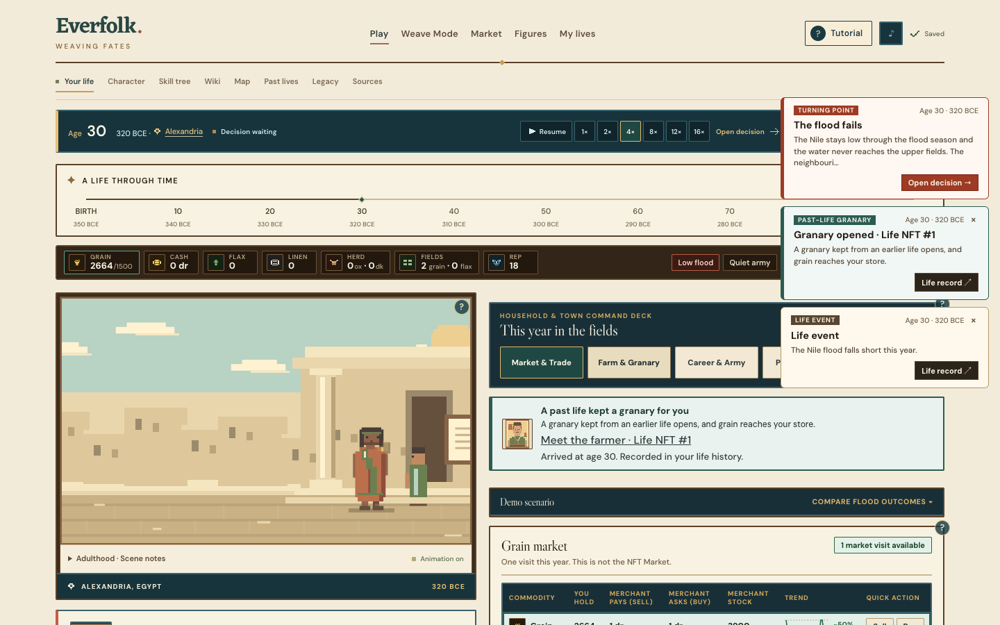
      </a>
      <p align="center"><b>Active Simulation &amp; Cross-Life Weave</b><br><sub>Past-life NFTs intervene at crises (e.g., unlocking stored grain during a low Nile flood) while tracking 1x–16x pacing, family ledger, and local markets.</sub></p>
    </td>
    <td width="50%" valign="top">
      <a href="https://everfolk.life/test/weave/convoy">
        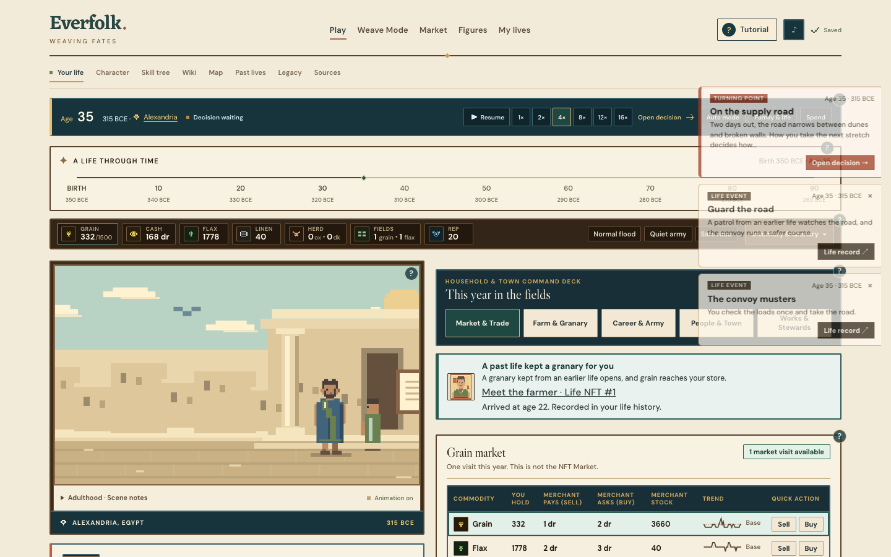
      </a>
      <p align="center"><b>Convoy Distinction &amp; Commodity Quotes</b><br><sub>Soldier patrol deeds reduce road ambushes while household grain &amp; flax quotes react dynamically to city shocks.</sub></p>
    </td>
  </tr>
  <tr>
    <td width="50%" valign="top">
      <a href="https://everfolk.life/skills">
        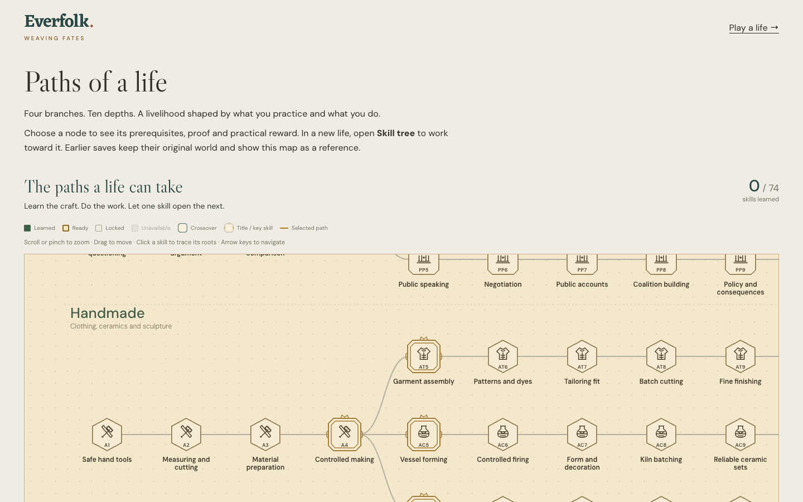
      </a>
      <p align="center"><b>74-Node Capability Atlas (<code>/skills</code>)</b><br><sub>Four branches and ten depth tiers uniting Physique, Handmade, Knowledge, Trade, and military crossovers.</sub></p>
    </td>
    <td width="50%" valign="top">
      <a href="https://everfolk.life/#market">
        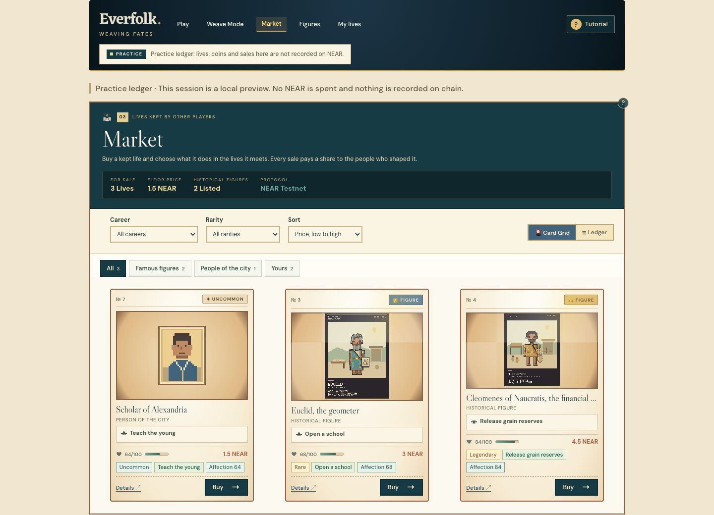
      </a>
      <p align="center"><b>Rhakotis Bazaar NFT Market (<code>#market</code>)</b><br><sub>Filter by career group, rarity tier, and deed; every resale routes source royalties transparently on-chain.</sub></p>
    </td>
  </tr>
</table>

---

## How Living Legacies Work

<table>
  <tr>
    <th width="25%">1. Seeded Birth</th>
    <th width="25%">2. Cross-Life Draws</th>
    <th width="25%">3. Proof &amp; Booster Pack</th>
    <th width="25%">4. Living Royalties</th>
  </tr>
  <tr>
    <td valign="top">Call <code>start_life</code> with an active world revision. NEAR block randomness determines family standing, origin, and initial world conditions.</td>
    <td valign="top">During critical moments (education, war, money, work, fate, spirit, harvest, road), <code>draw_npc</code> picks an active pool token weighted by Affection.</td>
    <td valign="top">Every 5 game years, <code>checkpoint</code> anchors progress on-chain. At death (age 18+), the verifier signs the full replay for <code>open_mint_pack</code>.</td>
    <td valign="top">Crack the 1–5 card foil pack, choose 1 NFT slot via <code>choose_mint_slot</code>, pick its deed, and earn <code>50%</code> mint + <code>5%</code> resale shares when future lives draw you.</td>
  </tr>
</table>

### Interactive Booster Pack & Card Reveal

<table>
  <tr>
    <td width="50%" valign="top">
      <a href="https://everfolk.life/test/weave/pack">
        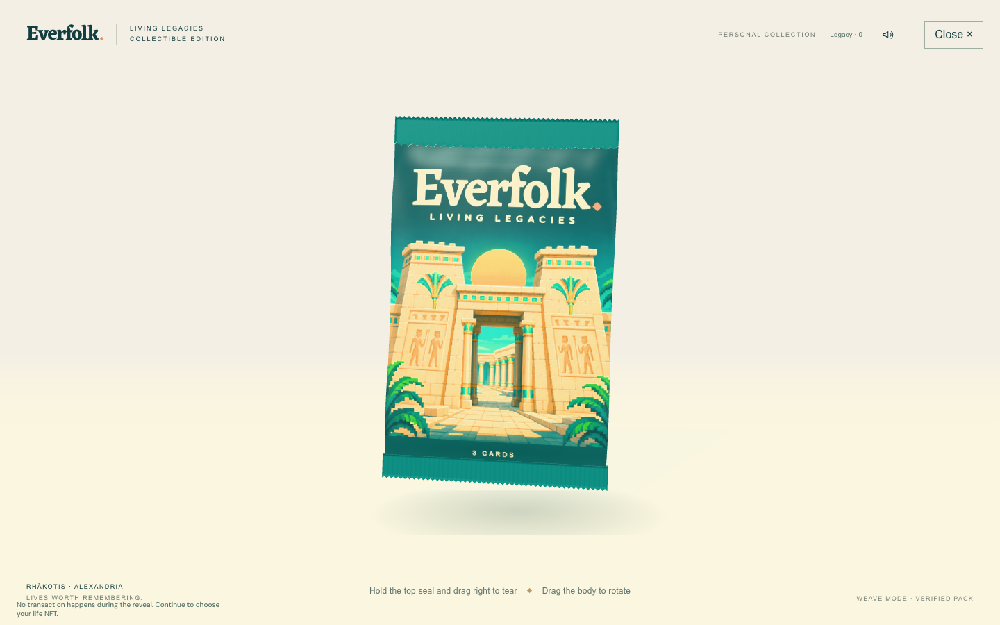
      </a>
      <p align="center"><b>Sealed Living-Legacies Pack (<code>/test/weave/pack</code>)</b><br><sub>Pack size scales from <b>1 to 5 cards</b>: zero below age 18, base 1/2/3 cards at ages 18+/40+/60+ plus bonuses for accomplishments and qualified historical figures.</sub></p>
    </td>
    <td width="50%" valign="top">
      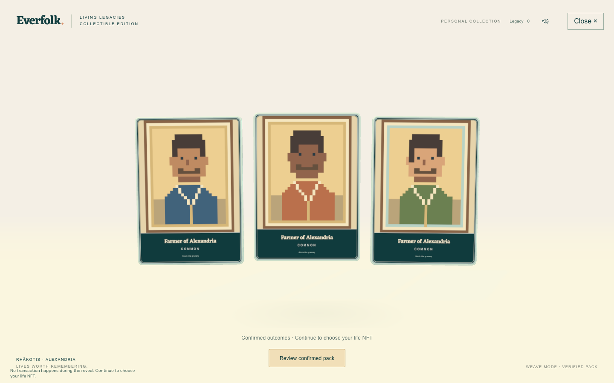
      <p align="center"><b>Confirmed Outcome Reveal &amp; Slot Pick</b><br><sub>All pack candidates reveal interactively in 3D WebGL before committing the final <code>choose_mint_slot</code> transaction on NEAR.</sub></p>
    </td>
  </tr>
</table>

---

## NFTs & Historical Collectibles

### Historical Figures (`5` Copies per Figure &middot; `5%` Qualified Drop Rate)

Qualifying for a historical figure requires sustained, multi-decade specialization calibrated across seeded simulations (~20–30% pass rate on deliberate runs; ~0% on unfocused runs). Meeting the criteria grants eligibility — final mint drops use a **5% (`500 bps`)** on-chain roll on the main contract until the `5`-copy supply cap is filled.

<table>
  <tr>
    <td width="25%" align="center" valign="top">
      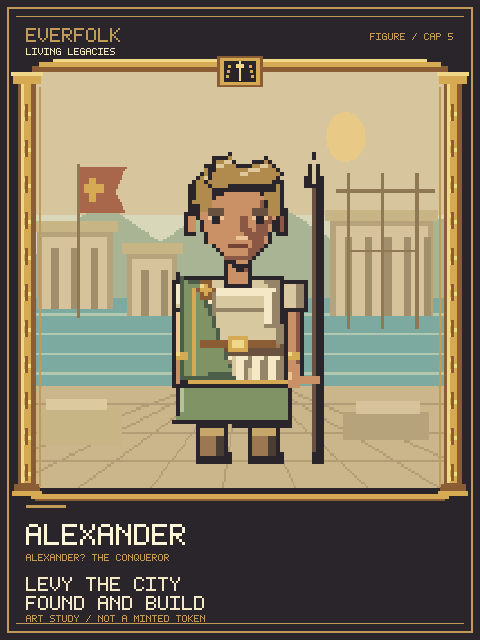<br>
      <b>Alexander the Great</b><br>
      <sub><code>alexander</code> &middot; Supply Cap <b>5</b></sub><br><br>
      <sub><b>Path (Ranked):</b> <code>royal-household</code> origin (1/100), <code>general</code> by age 32, <code>warfare &ge; 70</code>, <code>oratory &ge; 50</code>, military prestige.</sub><br>
      <sub><b>Deeds:</b> <code>alexander.levy</code> &middot; <code>alexander.found</code></sub>
    </td>
    <td width="25%" align="center" valign="top">
      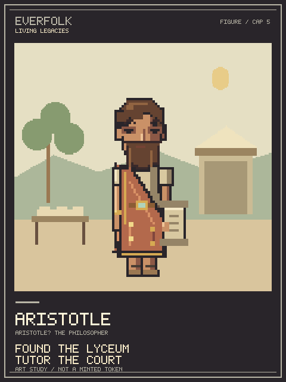<br>
      <b>Aristotle</b><br>
      <sub><code>aristotle</code> &middot; Supply Cap <b>5</b></sub><br><br>
      <sub><b>Path:</b> Age 30+, <code>philosophy-tutor</code> or <code>court-adviser</code>, <code>literacy &ge; 76</code>, <code>philosophy &ge; 76</code>, <code>oratory &ge; 50</code>, <code>knowledge &ge; 60</code>.</sub><br>
      <sub><b>Deeds:</b> <code>aristotle.lyceum</code> &middot; <code>aristotle.tutor-court</code></sub>
    </td>
    <td width="25%" align="center" valign="top">
      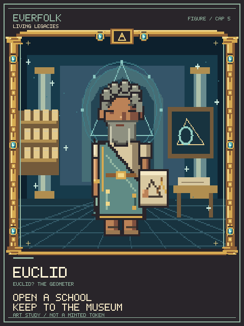<br>
      <b>Euclid</b><br>
      <sub><code>euclid</code> &middot; Supply Cap <b>5</b> (<b>3/5 Live</b>)</sub><br><br>
      <sub><b>Path:</b> Age 25+, <code>sky-table-calculator</code> / <code>patron-supported-reader</code> / <code>philosophy-tutor</code>, <code>reckoning &ge; 80</code>, <code>literacy &ge; 70</code>.</sub><br>
      <sub><b>Deeds:</b> <code>euclid.school</code> &middot; <code>euclid.museum</code></sub>
    </td>
    <td width="25%" align="center" valign="top">
      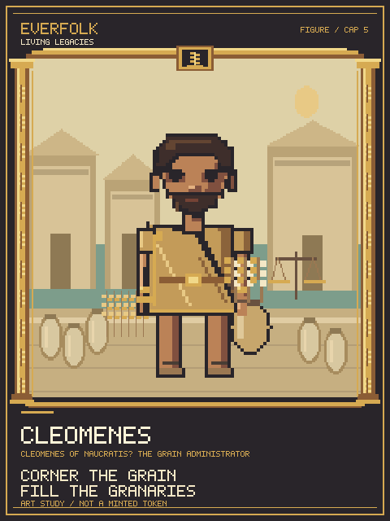<br>
      <b>Cleomenes</b><br>
      <sub><code>cleomenes</code> &middot; Supply Cap <b>5</b></sub><br><br>
      <sub><b>Path:</b> Age 30+, <code>court-adviser</code> or <code>shopkeeper</code>, <code>reckoning &ge; 80</code>, <code>literacy &ge; 50</code>, <code>wealth &ge; 90</code>, commerce prestige.</sub><br>
      <sub><b>Deeds:</b> <code>cleomenes.corner-grain</code> &middot; <code>cleomenes.granaries</code></sub>
    </td>
  </tr>
</table>

<p align="center">
  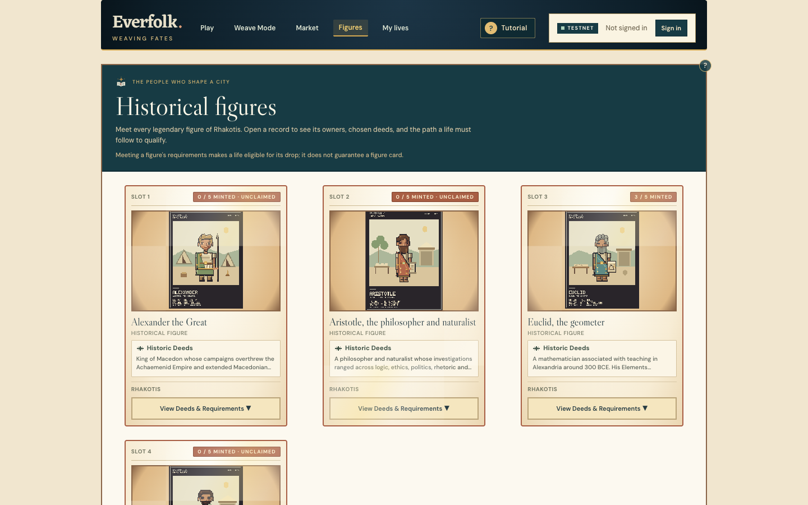
</p>

### Citizen NFTs, Career Groups & Stage Albums

Beyond the 4 legendary figures, every ranked life mints into a **Citizen NFT** across **7 career groups** and **8 on-chain draw categories**, plus milestone **Stage Albums** captured at youth, adulthood, and later life:

| Career Group | Draw Category | Selectable On-Chain Deeds (`chain/catalog/contract-catalog.json`) |
|---|---|---|
| **Letters** | `education` | `letters.teach` &middot; `letters.lend-books` |
| **Military** | `war`, `road` | `military.mentor` &middot; `military.warn-levy` &middot; `military.guard-road` |
| **Commerce** | `money` | `commerce.credit` &middot; `commerce.hire` |
| **Craft** | `work` | `craft.apprentice` &middot; `craft.commission` |
| **Sky** | `fate` | `sky.omen` &middot; `sky.warn-year` |
| **Performance** | `spirit` | `performance.lift` &middot; `performance.lend-hand` |
| **Farming** | `harvest` | `farming.stock-granary` &middot; `farming.share-seed` |

Owners can switch an NFT's active deed via `set_action` (except the special-purpose `alexandria-demo-2` demo world when testing isolated granary/convoy triggers), list or buy via `list` / `buy`, and inspect on-chain impact with [`sources_of`](contract/README.md) &amp; [`children_of`](contract/README.md).

---

## Smart Contracts & Protocol Parameters

### Verified NEAR Testnet Deployments

| Deployment | Account ID | Explorer | Purpose &amp; Live Rules |
|---|---|---|---|
| **Primary Live Contract** | `everfolk-albums-11121956.testnet` | [NearBlocks &nearr;](https://testnet.nearblocks.io/address/everfolk-albums-11121956.testnet) | Active production testnet contract supporting **Booster Packs**, **Stage Albums**, `5%` figure drop, and full source royalty graph (`alexandria-ranked-1`, `alexandria-demo-2`). |
| **Legacy v1 Contract** | `everfolk-lives-11101338.testnet` | [NearBlocks &nearr;](https://testnet.nearblocks.io/address/everfolk-lives-11101338.testnet) | Initial v1 deployment (`1 NEAR` mint fee, `alexandria-ranked-1`, pre-stage-albums). Existing tokens remain readable on-chain. |
| **Rehearsal / Demo Contract** | `demo.genesis-1794297139-6.testnet` | [NearBlocks &nearr;](https://testnet.nearblocks.io/address/demo.genesis-1794297139-6.testnet) | Isolated demonstration deployment (`100%` qualified figure drop, `0` nobody draw weight, `0` abandon cooldown) used for walkthrough recording. |

- **Standards Implemented:** `NEP-171` (NFT Core), `NEP-177` (Metadata), `NEP-178` (Approvals), `NEP-181` (Enumeration), `NEP-199` (Payouts).
- **Live Verifier Public Key:** `ed25519:D7qBge3EHhD8NFSwqH1JHLRTLFQQUxQZbiLRDdz3Lkk` (exposed via [`GET /api/ranked/config`](server/ranked/routes.ts)).
- **Default Testnet RPC:** `https://test.rpc.fastnear.com` (overridable via `NEAR_RPC_URL`).

### On-Chain Economics, Rarity & Protocol Bounds

<table>
  <tr>
    <td width="50%" valign="top">

**Fee &amp; Royalty Schedule (`everfolk-albums-11121956.testnet`)**

| Parameter | Value | Description |
|---|---|---|
| `mint_fee` | `0.001 NEAR` | Minting &amp; booster pack settlement (`10^21` yoctoNEAR) |
| Stage Album Fee | `0.002 / 0.01 NEAR` | Generic stage record vs. historical figure stage stamp |
| `source_mint_share_bps` | `5000` (`50%`) | Mint fee share distributed by impact to upstream sources |
| `royalty_sources_bps` | `500` (`5%`) | Secondary sale royalty paid proportionally to sources |
| `royalty_treasury_bps` | `500` (`5%`) | Secondary sale royalty routed to protocol treasury (`10%` total) |
| `drop_rate_bps` | `500` (`5%`) | Figure drop chance on eligible lives (cap `5` per figure) |
| `nobody_weight_bps` | `5000` (`50%`) | Baseline draw weight allocated to uninfluenced turns |
| `abandon_cooldown_ms` | `600000` (`10 min`) | Cooldown after abandoning an active life |

  </td>
  <td width="50%" valign="top">

**Gas Floors, Rarity Scaling &amp; Storage Bounds**

| Constraint | Value | Notes |
|---|---|---|
| `mint_life` / `retry_mint` Gas | `200 Tgas` | Includes dedicated `150 Tgas` private resolver receipt |
| `open_mint_pack` Gas | `150 Tgas` | Commits verified pack outcomes before reveal choice |
| `draw_npc` Gas | `100 Tgas` | Samples Affection-weighted token from category pool |
| Per-Life Draw / Checkpoint Cap | `128` / `128` | Max recorded NPC draws and 5-year checkpoints |
| Pool / Source Cap | `1000` / `64` | Max pooled NPCs per category; max upstream sources per NFT |
| Rarity Impact Multiplier | `1.0x` – `3.0x` | Common `10000`, Uncommon `12500`, Rare `15000`, Epic `20000`, Legendary `30000` bps |
| Figure Supply Cap | `5` per figure | Checked atomically inside resolver to prevent races |

  </td>
  </tr>
</table>

<details>
<summary><strong>Smart Contract Methods, Auth &amp; Play-Key Model, and Honest Limits</strong></summary>

#### Contract Interface (`contract/README.md`)

| Area | Methods |
|---|---|
| **Lives** | `start_life`, `abandon_life`, `draw_npc`, `checkpoint`, `get_life`, `active_life_of` |
| **Packs &amp; Mint** | `open_mint_pack` (payable), `choose_mint_slot`, `mint_life` (payable), `retry_mint` (payable), `mint_result`, `set_action`, `figure_supply` |
| **Stage Albums** | `mint_stage_record` (payable), `stage_mint_quote` |
| **Earnings &amp; Graph** | `withdraw`, `balance_of`, `sources_of`, `children_of`, `token_stats` |
| **Market (`NEP-199`)** | `list`, `unlist`, `buy` (payable), `listing`, `listings`, `nft_payout`, `nft_transfer_payout` |
| **Pools &amp; Admin** | `active_pool`, `figure_copies`, `set_verifier_keys`, `set_catalog`, `set_params`, `set_world_versions` |

#### Dual Authentication (`Weave Mode`)

- **NEAR Wallet Connect:** Standard wallet signing via `@hot-labs/near-connect`.
- **Privy Email + Play Key:** Players without an external wallet can sign in via email (`@privy-io/react-auth`), provisioned with a scoped testnet play key backed by the configured funder account (`EVERFOLK_FUNDER_ACCOUNT_ID`).

#### Honest Limits

- **Randomness:** Relies on NEAR block randomness (`env::random_seed()`, validator VRF), suitable for testnet; offline lookahead between 5-year checkpoints is constrained by future-block draws.
- **Verifier Trust Model:** Currently operated as a signed Edge Worker service (`RANKED_VERIFIER_SECRET`) behind a modular `LifeVerifier` interface so a TEE verifier can swap in without changing contract verification.
- **External vs. In-Game Marketplaces:** External `NEP-199` marketplaces receive payout maps truncated to their `max_len_payout` (unfitted remainder routes to treasury); Everfolk's native market pays every source up to the 64-source cap.

</details>

---

## Architecture & System Design

### 1. System Topology & Runtime Boundaries

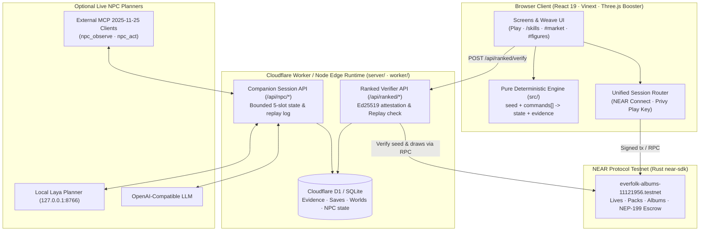

### 2. Ranked Proof-Before-Mint Sequence

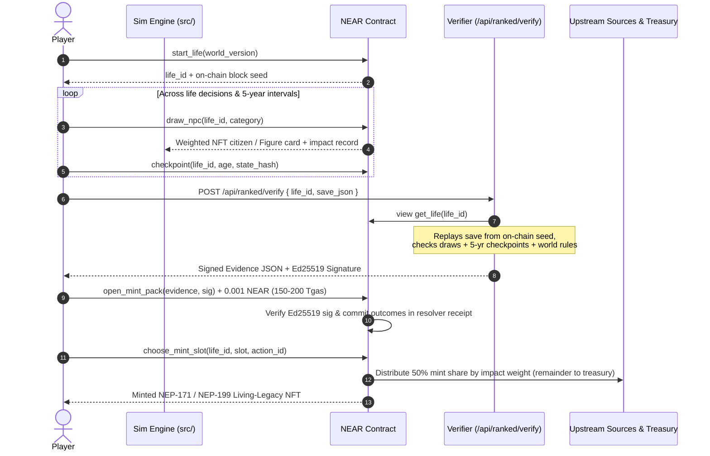

### 3. Source Influence & `NEP-199` Royalty Flow

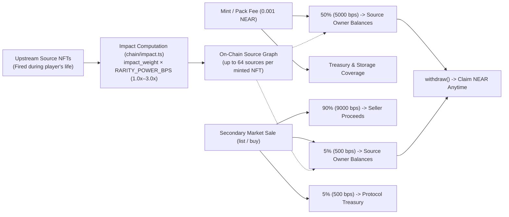

### 4. Codebase Layer Ownership

Strict unidirectional imports across modules are mechanically verified in CI by [`pnpm check:structure`](scripts/check-structure.mjs) and detailed in [ARCHITECTURE.md](ARCHITECTURE.md):

| Directory | Responsibility &amp; Allowed Dependencies |
|---|---|
| [`src/`](src) | Pure headless deterministic simulation (calendar, RNG, stats, skills, family, commerce, war, command reducer, serialization). Zero React, browser DOM, or server dependencies. |
| [`chain/`](chain) | Shared immutable rules, action/figure catalogs (`contract-catalog.json`), impact math, pack-size formula, save verification helpers used by both client and verifier. |
| [`client/`](client) | UI layer organized strictly as `types` &rarr; `lib` &rarr; `models` &rarr; `state` &rarr; `queries` &rarr; `mutations` &rarr; `hooks` &rarr; `components` &rarr; `screens`, plus `chain/` Weave screens and `demo/`. |
| [`contract/`](contract/README.md) | Rust `near-sdk` workspace implementing `Everfolk` lives, packs, stage albums, market escrow, and `NEP-171`–`NEP-199` views/callbacks. |
| [`server/`](server) &middot; [`db/`](db) &middot; [`worker/`](worker) | Vinext route handlers, D1/SQLite Drizzle schema, Ed25519 `LifeVerifier`, rate limits, and standalone/ranked `/npc` companion services. |
| [`worlds/`](worlds) &middot; [`scripts/`](scripts) | Versioned immutable world JSON packs (retaining historical saves) and CLI generators/evaluators (`ranked:world`, `demo:world`, skill cohort evaluation). |

---

## Skill Atlas & Economy

Everfolk models livelihoods through connected prerequisites, proficiency gates, and **demonstrated-work proof** rather than abstract XP bars:

- **74-Node Attribute Atlas (`/skills`):** Spans **Physique**, **Handmade**, **Knowledge**, and **Trade** across 10 depth tiers, with two explicit crossovers bridging intellectual inquiry and physical conditioning into **Military Foundations** and **Tactical Command** ([Military progression guide](guide/SKILL_CROSSOVERS.md)).
- **Classic Alexandria Economy (`alexandria-lives-8`):** Players manage grain reserves, flax fields, linen production, herds, and household rations. Year-end bulk commodity contracts execute against merchant stock and event-reactive quotes (capped at `50` units/order &amp; `100` units/year for ordinary households, expanded to `100` units/order &amp; `300` units/year and full catalog browsing for traders, shopkeepers, merchants, estate stewards, and quartermasters).
- **Calibrated Cohort Benchmarks (`alexandria-lives-8`):** Across an **800-life seeded evaluation** (100 seeds &times; 8 terminal paths under disclosed balanced policies, reported in [`guide/SKILL_TREE.md`](guide/SKILL_TREE.md)), depth-10 specialization rates fall consistently within **55.0%–64.0%**, with zero artificial state injection.

<p align="center">
  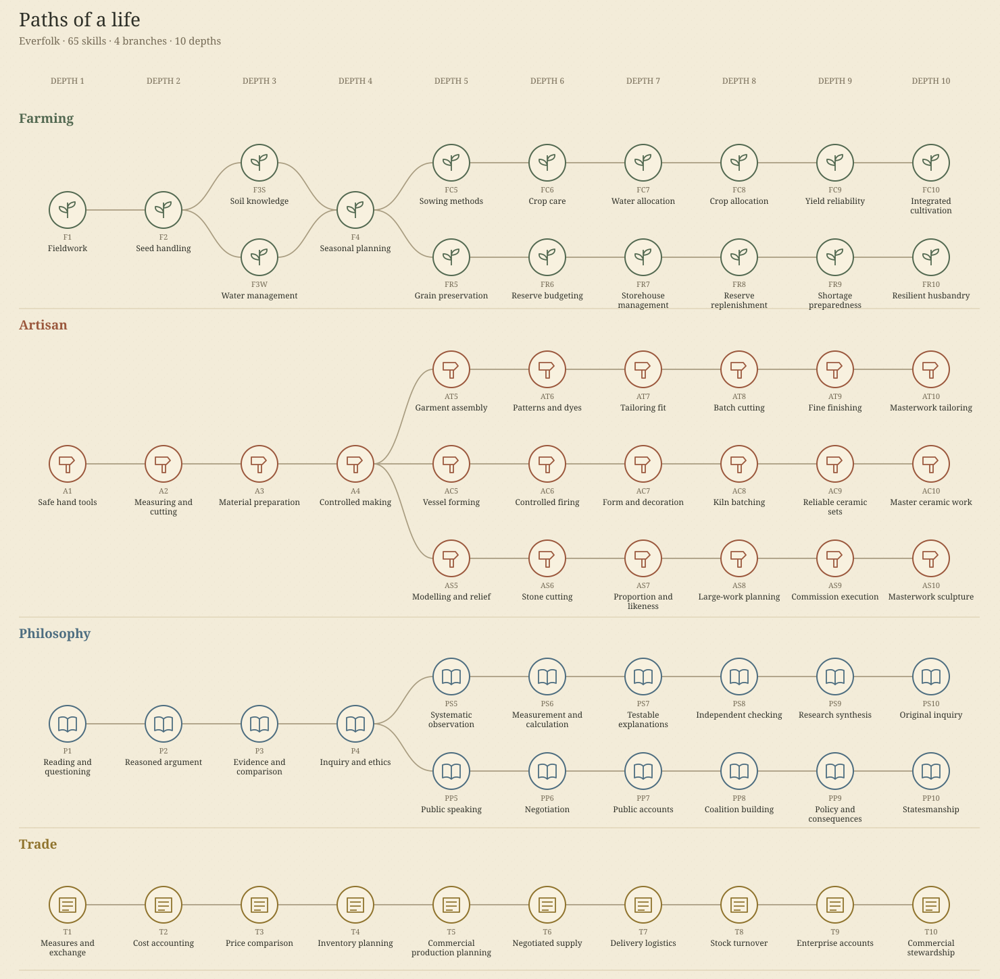
</p>

---

## NPC Companions & Agent Runtime

Visit [`/npc`](https://everfolk.life/npc) to run an online life shared with **five persistent companion slots** (2 caregivers, mentor, merchant, and peer) operating on real household and market accounts:

- **Deterministic Fallback + Live AI:** Rules keep gameplay running cleanly even without an external LLM. Connect **Local Laya** (`127.0.0.1:8766`, up to `1000` calls/life &amp; `5000`/day) for fast local action selection, or any **OpenAI-compatible endpoint** (`100` calls/session, `200`/day) for rich dialogue.
- **External MCP (`2025-11-25`) &amp; REST Control:** External agents can inspect state and act directly via `npc_observe`, `npc_actions`, `npc_act`, and `npc_events` or `/api/npc/sessions/:id/*`.
- **Fair Play Separation:** Standalone `/npc` sessions never mint NFTs; Weave Mode `alexandria-npc-1` gates ranked reward verification with `requireLiveProviderForRewards` and logs provider outages cleanly (`30s` cooldown). See [NPC Setup &amp; MCP Guide](guide/NPC_AGENTS.md) and [Judge Readiness](guide/JUDGE_READINESS.md).

---

## Quickstart

### Prerequisites

- **Node.js `24+`** &amp; **pnpm `11.25.0`**
- **Rust + `cargo-near`** (only needed to rebuild or unit-test the NEAR smart contract)

### 1. Run Locally (Browser Game + Worker SSR)

```sh
pnpm install --frozen-lockfile
pnpm dev
```

Free play works out of the box with no account or secrets (`LocalStorage` + JSON import/export). For local Weave Mode testing, set `RANKED_VERIFIER_SECRET=<64-hex>` in `.dev.vars`.

### 2. Run with Docker (Production Bundle on `workerd`)

```sh
cp .env.production.example .env.production   # configure verifier key, funder, Privy ID
docker compose up -d --build                 # serves http://localhost:8787 with persistent /data D1 volume
docker compose logs -f everfolk
```

Put a TLS reverse proxy (Caddy or nginx) in front of port `8787` and add the public origin to your Privy app's allowed origins.

### 3. Verification, Builds &amp; Contract Tests

<details>
<summary><strong>Development Commands, Contract Testing &amp; Testnet Deployment Scripts</strong></summary>

```sh
# Workspace verification (matches GitHub Actions verify job)
pnpm check              # TypeScript typecheck + English-only check + architecture boundaries
pnpm test               # Unit, replay, figure calibration & world invariant test suites
pnpm build              # Production Vinext + Cloudflare Worker bundle
pnpm preview            # Preview production build locally
```

```sh
# NEAR Smart Contract (Rust unit suite inside contract/)
cd contract
cargo test --locked --lib
cargo near build non-reproducible-wasm
```

```sh
# Testnet deployment & smoke verification helpers
CONTRACT_ID=everfolk-albums-demo.testnet VERIFIER_PUBLIC_KEY=ed25519:... scripts/ranked/deploy-contract.sh
CONTRACT_ID=everfolk-albums-demo.testnet KEEP_VERIFIER_KEY=ed25519:... scripts/ranked/smoke.sh
```

```sh
# Regenerate active world packs (retain previous immutable worlds/*.json for existing saves)
pnpm content
```

</details>

---

## Classic Alexandria households and portraits

Classic Alexandria lives record named parents and grandparents with their household backgrounds and occupations. Living grandparents are rare: 10% of new households start with one. Open Family for a table of living relatives, your spouse and children, with deceased relatives kept under Remembered family. Relationships lists friends, business partners, teachers, disciples, enemies and romantic relationships as they form, alongside backgrounds, work and recorded bonds.

Classic Alexandria lives offer work shaped by their household background, with farming as an optional livelihood. Independent material trades use purchased supplies to produce goods for sale. Place bulk market contracts during the year: cash or stock is reserved immediately, and deliveries and sale receipts settle at the next year end. Quotes respond to events reported in the life. Choosing the Trading focus puts ordinary work aside; repeated years of completed sales can open the trader occupation.

The market shows resources useful to your current work and background, goods you own or have ordered, and supplies for tasks you can take. Traders, shopkeepers, merchants, estate stewards and quartermasters can browse the full catalogue with search and category filters because their work involves broad purchasing or resale. Other occupations keep a focused selection. Starting-resource displays focus on your household's rolls and possessions.

In new classic Alexandria lives, royal births follow a separate household council path. Guide the house treasury, court influence, household stability, security and succession, with private lessons from age eight and council responsibilities from sixteen. Household staff handle trade and ordinary work; royal decisions concern envoys, guards, petitions, estate obligations and family agreements. Personal health, family and historical changes still shape the life. This fictional minor royal branch does not automatically inherit Egypt's throne. Earlier saves retain their original rules.

Aristocrats born into the landowning estate household manage an Estate council: invest in land and storage, settle tenant agreements, maintain local patronage, collect rents and plan the family's inheritance. Estate prosperity and tenant loyalty affect annual returns. Their staff handle ordinary trade and paid work. New lives have a 6% chance of an aristocratic birth and a 2% chance of a royal birth; these are authored game probabilities, increased from 3% and 1%. Begun lives keep their original world revision.

For a local preview of the full game and ready-to-play class scenarios, run `node scripts/preview-lives.mjs`. The game opens at `http://localhost:5175/`, with isolated adult scenarios at `/test-aristocrat` and `/test-royalty`. Both test routes use the regular life screen, year controls, event feed and management dialog, with a small preset selector. Test sessions do not write personal saves; normal play at the root uses browser saves. The preview serves the bundled worlds locally without a database.

Royal and aristocratic births receive a congratulations popup after the starting-stat reveal and **Begin life**. A skippable four-step tour introduces their treasury, household conditions, yearly council decisions and earned titles; time waits while the tour is open. **Household guide** in the character panel reopens it. Both class test pages show the introduction and include **Try birth welcome** to test the complete newborn reveal and tutorial without personal saves.

Each council contains three earned title paths. Royal households pursue Ambassador of the House, Guardian of the House or Unifier of the House; estate households pursue Restorer of the Estate, Trusted Patron or Keeper of the Family Lands. A path requires an actual council service, three accepted duties across several years, maintained household conditions and a final recognition action. The two middle projects can fail, spend their budget and require two years before a retry. Recognition adds 5 drachmas to the household treasury each year. These are fictional household distinctions. They also develop practical skills; treasury-funded lessons and historical service opportunities let either class pursue the existing historical titles within their original dates and recognition odds.

New lives limit ordinary household contracts to 50 units per order and 100 total units per year. Roles with full market access can commit 100 units per order and 300 per year. Purchases and sales share that yearly allowance, including orders split across different goods. Cancelling a contract releases its allowance; completing the year renews it. At most eight contracts may be pending.

The bundled classic Alexandria world groups eight earned historical title paths and their milestone sub-cards, including Right Hand of Alexander, General of Alexander, and scholarly work associated with Aristotle, Euclid and Theophrastus. Scholarly paths use independent study and reviewed work, without requiring personal lessons or teaching-window deadlines. Complete a path's tasks and recognition review to collect its sub-cards under your character's name. Works & deeds shows preparation and progress; the collection can filter by historical figure.

The portrait libraries retain their source manifests, QA records and dependencies. The application delivers 240 v3 portrait PNGs. Begun lives retain their exact world revision.

---

## Guides & Documentation

| Document | Topics Covered |
|---|---|
| [Project Report](guide/REPORT.md) | Protocol design rationale, 4 on-chain mechanics, figure calibration &amp; honest limits |
| [How to Play (Tutorial)](guide/TUTORIAL.md) | Step-by-step Alexandria life walkthrough &amp; UI controls |
| [Example Euclid Life (#12)](guide/EXAMPLE_LIFE.md) | Verifiable real playthrough that unlocked &amp; minted Euclid on NEAR testnet |
| [Skill Tree &amp; Benchmarks](guide/SKILL_TREE.md) | 74-node progression model &amp; 800-life seeded mastery data |
| [Military Crossovers](guide/SKILL_CROSSOVERS.md) | Requirements joining Physique and Knowledge into military command |
| [NPC Companions &amp; MCP](guide/NPC_AGENTS.md) | Local Laya, OpenAI-compatible setup, REST API &amp; MCP tool specification |
| [Judge Readiness](guide/JUDGE_READINESS.md) | Verification boundaries between standalone `/npc` preview and Weave Mode |
| [Smart Contract Reference](contract/README.md) | Method catalog, gas floors, storage economics &amp; failure recovery |
| [Architecture &amp; Contributing](ARCHITECTURE.md) &middot; [CONTRIBUTING.md](CONTRIBUTING.md) &middot; [ROADMAP.md](ROADMAP.md) | Module dependencies, PR-free branch rules &amp; development phases |

---

## Assets, Typography & Attributions

- **Brand System (Printed Folktale):** Bundles `Eczar 600` wordmarks/headings and `DM Sans 500` narrative typography under the SIL Open Font License ([`public/fonts/`](public/fonts), [`artwork/branding/everfolk-printed-folktale/`](artwork/branding/everfolk-printed-folktale/README.md)).
- **Original Artwork &amp; Media:** Original pixel scenes, 480&times;640 figure collectible cards, paper cutout plates, and vector skill atlas remain in `public/assets/`. Bundled audio source records and license texts reside in `public/assets/audio/`. Historical contexts are sourced, while individual characters, prices, probabilities, and scenes remain authored fictional illustrations rather than archaeological reconstructions.
