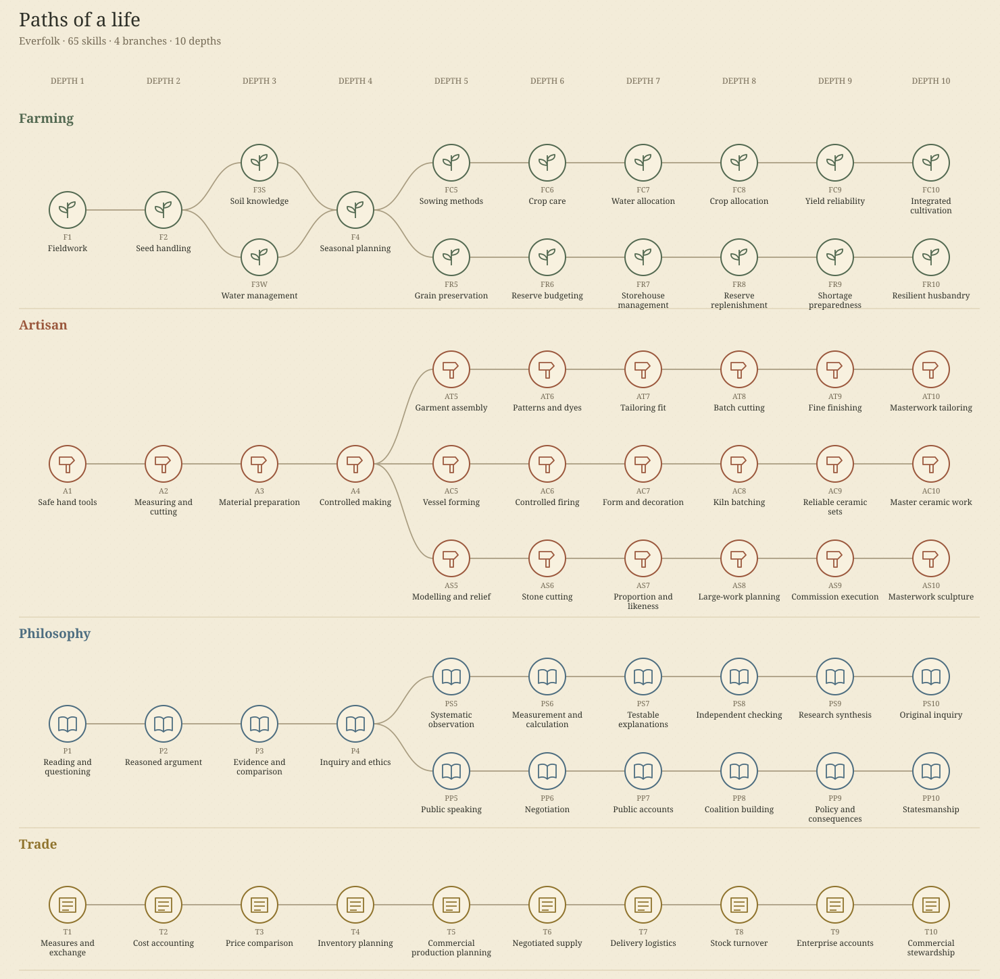

# Paths of a life

Open `/skills` after starting the local server to inspect the complete atlas without creating a save. In a game, use **Skill tree** in the top navigation or **Character → Skills**.

The atlas contains 74 connected capabilities across Physique, Handmade, Knowledge and Trade. All paths remain visible. Choose a node to light its complete path from the root and inspect its prerequisites, proficiency thresholds, demonstrated-work proof, quoted action and practical reward. Scroll to zoom around the pointer and drag the map to explore; touchscreens support dragging and pinch zoom. Use **Read selected path** to center the selected skill at reading size, **Fit whole tree** to return to the overview, or the named-node picker on a small screen. Arrow keys follow connected skills.



## Learning and work

A capability needs its parent nodes, the required proficiency and accepted work evidence. Proficiency alone never awards it. Ordinary work develops its named primary and support skills; deliberate practice develops the selected score. A work action uses that year's major activity. Inspecting the map changes nothing.

Farming evidence settles after the real harvest and household food ledger. Artisan work consumes owned or explicitly purchased inputs, pays workshop fees and produces graded goods; learned methods control batch size, quality and inspection. Inquiry and civic assessments retain their evidence, fees and funded payments. Trade work records paid baskets, quotations and fulfilled supply orders. A multi-year assessment counts active work years and keeps its reserved inputs/payment while paused.

Locked nodes explain missing requirements. Unavailable nodes remain inspectable when an older world does not support the new progression. Careers are consequences and offers shown in node details, rather than separate skill nodes.

## Saves and versions

New free-play births use `alexandria-lives-8`, with capability graph version 3, proof from work (introduced in `alexandria-lives-7`) and the historical figure paths: each year of a matching yearly activity (such as woodwork or writing practice) and each year worked in a job counts as one proof year toward the next open skill on that lane, and the skill is learned automatically once its proof years are done. Like recorded work, the step must already be open when the year's practice begins. Steps whose recorded work feeds the next step or is itself the assessment (T2, PS8, AS5, FC8, T10 and every project step) still need recorded work. Already-started lives retain their exact immutable world. The retained `alexandria-lives-1`, `alexandria-lives-2`, `alexandria-lives-3`, original `alexandria-lives-4`, `alexandria-lives-5` (recorded work only), `alexandria-lives-6` (figure paths on lives-5, recorded work only), `alexandria-lives-7` (no figure paths), demo and ranked packs remain available for save/load and replay. An old life can inspect the atlas as a reference; it is not silently granted new proofs or replay rules. Start another life to play the new progression.

## Reproduce and verify

```sh
node scripts/vocations/build-world.mjs
node scripts/skills/build-atlas.mjs
pnpm check
pnpm test
pnpm build
```

The focused-play evaluation uses ordinary accepted game commands, three of four eligible work years on a chosen path, safe disclosed choices, and finite accounts. It counts early deaths and separately reports adult survivors. It never injects learned nodes or cash:

```sh
node scripts/skills/evaluate-focus.mjs 100
```

The current balance target is a **45–65%** birth-cohort rate of reaching depth 10 on one specialization (not learning every sibling node; the earlier design proposed 50–60%). Numerical balance is an authored gameplay model; the cohort evaluator's published output is the evidence for any measured rate, rather than a promise about every seed.

To regenerate and write the evidence bundle locally:

```sh
node scripts/skills/evaluate-focus.mjs 100 "" design/skill-tree/mastery-cohort-evidence.json
```

## Measured cohort evidence (`alexandria-lives-8`)

Published dataset: [`design/skill-tree/mastery-cohort-evidence.json`](../design/skill-tree/mastery-cohort-evidence.json)
- **World revision**: `alexandria-lives-8` (`worldFingerprint`: `fnv1a64-ae23b3454c2d9e4d`, recorded at commit `3e0fc88`)
- **Cohort & seeds**: 100 seeded lives per specialization (`skill-focus-0` … `skill-focus-99`, 800 total runs)
- **Disclosed policy**: Three of every four eligible adult work years focus the chosen path (`age % 4 !== 3`), using ordinary accepted commands only (surplus grain sold after reserving next-year seed and household rations, deliberate practice on unmet proficiencies, `PP8` civic work while district reputation is below 60, Auto-mode safe choices, apprentice fallback on cash/material blocks, zero state or cash injection). Early deaths before age 18 remain in the primary completion rate and are reported alongside the adult-survivor rate.

| Target | Rate (n=100) | 95% Wilson CI | Died &lt;18 | Adult Mastery | Median Age | Low-wealth (`delta-newcomers`, n=29) | Ordinary starts (n=71) | Main non-completion bottlenecks |
| --- | --- | --- | --- | --- | --- | --- | --- | --- |
| `FC10` | 59.0% | 49.2–68.1% | 1 | 59.6% (59/99) | 58 | 65.5% (19/29) | 56.3% (40/71) | 37 proof, 2 materials (`64` seed-blocked turns), 1 skills, 1 early death |
| `FR10` | 64.0% | 54.2–72.7% | 1 | 64.6% (64/99) | 59 | 62.1% (18/29) | 64.8% (46/71) | 31 proof, 4 skills (`650` detour turns), 1 early death |
| `AT10` | 57.0% | 47.2–66.3% | 1 | 57.6% (57/99) | 61 | 69.0% (20/29) | 52.1% (37/71) | 42 proof (`2,911` proof turns; `337` skill detours), 1 early death |
| `AC10` | 62.0% | 52.2–70.9% | 1 | 62.6% (62/99) | 58 | 65.5% (19/29) | 60.6% (43/71) | 34 proof, 3 skills (`341` detour turns), 1 early death |
| `AS10` | 55.0% | 45.2–64.4% | 1 | 55.6% (55/99) | 57 | 72.4% (21/29) | 47.9% (34/71) | 32 proof, 12 skills (`951` detour turns), 1 early death |
| `PS10` | 62.0% | 52.2–70.9% | 1 | 62.6% (62/99) | 60 | 79.3% (23/29) | 54.9% (39/71) | 31 proof, 6 skills (`849` detour turns), 1 early death |
| `PP10` | 62.0% | 52.2–70.9% | 1 | 62.6% (62/99) | 58 | 72.4% (21/29) | 57.7% (41/71) | 28 proof, 9 skills (`937` detour turns), 1 early death |
| `T10` | 60.0% | 50.2–69.1% | 1 | 60.6% (60/99) | 57 | 65.5% (19/29) | 57.7% (41/71) | 30 proof, 9 skills (`871` detour turns), 1 early death |

**Resource, proof and start-wealth diagnostics:**
- **Proof duration & skill detours** (`2,104–2,911` proof-advancing adult turns and `337–951` proficiency-detour turns per 100-life cohort) account for virtually all missed finishes before late-life mortality.
- **Materials & cash**: Because the policy markets annual grain surpluses after reserving next-year rations and seed, direct cash (`0` turns) and commercial opportunity blocks (`0` turns) were avoided in the 100-seed cohorts (`PP10` explicitly works `PP8` until reputation 60); `FC10` still recorded `64` seed-material blocked turns (2 final stops at `FC9`).
- **Low-wealth vs. ordinary starts**: Under `proofFromWork`, `delta-newcomers` starts (20–80 dr initial cash, 207–417 dr net worth) matched or exceeded ordinary household starts across paths (62.1%–79.3% vs. 47.9%–64.8%).

Earlier historical baseline: the older retained `alexandria-lives-3` 10-seed smoke cohort reached mastery only on Resilience (3/10; 0/10 on the other seven paths) prior to proof-from-work and pacing revisions. For the military lane (`M10`), see [military crossovers](SKILL_CROSSOVERS.md).
