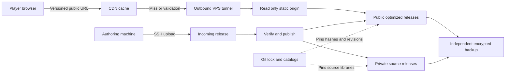

# Everfolk artwork storage and delivery system

Design date: 13 November 2026. Status: implementation package prepared for a future VPS deployment. Server specifications, domain, transfer allowance, CDN service entitlement and backup destination remain to be supplied.

The application repository will contain code, immutable world revisions, licensing information, small source receipts and asset version references. A private VPS archive will hold editable artwork and its history. Selected optimized exports will be served through a CDN from an isolated static origin on the VPS. Asset generation runs on an authoring machine; the VPS performs file serving, verification and backup.

## Goals and boundaries

The first migration should reduce tracked checkout payload below 300 MB. Removing bulk artwork and raw sources gives a measured baseline of 270.4 MB before retaining generators and small fixtures. Moving selected delivered media later creates additional headroom. Historical Git objects require a separate migration; a smaller current tree alone does not make an ordinary full clone small.

Normal development must not download the complete artwork archive. Builds and tests use pinned delivery files or a deliberately materialized delivery release. Editing sources requires explicit retrieval of the relevant library and its dependency libraries. Source review and approval states must survive migration unchanged.

The setup package does not modify application image URLs, delete artwork, rewrite Git history, change SSH configuration, install Docker, open public host ports or deploy to an account. It prepares the storage and serving boundary. Integration and history migration follow verified storage and recovery.

## Request and authoring paths



The browser first checks its own cache. A CDN hit uses CDN transfer and player download bandwidth without asking the VPS. A CDN miss, eviction, purge or validation can contact the VPS, even for an old image. Separate edge locations can need their own copies. A long freshness lifetime does not guarantee cache retention. [Cloudflare retention and freshness](https://developers.cloudflare.com/cache/concepts/retention-vs-freshness/)

Private source data has no web route and is never mounted into the origin container. Public consumers can access only published delivery releases. The application never receives an archive credential or upload credential.

## Storage and version contract

```text
/srv/everfolk-art/
  public/releases/<release-id>/
    manifest.json
    payload/<original-relative-path>
  private/releases/<release-id>/
    manifest.json
    payload/<original-relative-path>
  incoming/                      Optional SSH upload staging, never served
  .staging/                      Root-controlled publication staging, never served
/opt/everfolk-art/                Compose runtime and trusted publishing tools
```

A release ID is a unique lowercase slug, for example `cards-v14-20261113-01`. The publisher refuses to replace an existing ID. Every regular payload file is listed with its relative path, byte length and SHA-256. Verification rejects missing files, additional payload files, links, unsafe paths and mismatched content. Publishing also requires a trusted manifest SHA-256 from the authoring machine or reviewed lock; matching files against only an uploaded manifest would not identify the intended release. Publication copies to a protected staging directory, verifies it against that trusted digest and uses an atomic rename on the destination filesystem. Atomic visibility is established; universal power-loss durability across arbitrary filesystems is not claimed.

Full release trees simplify recovery and inspection. They duplicate unchanged content across releases; this version does not implement content-addressed deduplication on the VPS. Publish source libraries independently rather than uploading a complete multi-gigabyte source snapshot for every small edit. Preserve older libraries that current art depends on. Backup software can deduplicate its own remote repository independently.

The proposed Git lock contains release ID, public base URL configuration key, manifest SHA-256, source-library dependencies, generator/tool versions, provenance/license references and review receipts. Keep the host address in environment or deployment configuration; hashes and logical identities survive a host change. The supplied packer creates release manifests; a project-specific lock and application URL resolver remain integration work.

Public payloads permit shipped raster images, fonts, audio, geometry/text SVG, CSS, JSON, static HTML credits and TXT/Markdown notices. A shared parser-backed Python policy validates text exports from both the Node packer and server publisher. SVG scripts, animation, foreign namespaces, external references, events, stylesheets and entity declarations are rejected; current shipped SVGs require none of them. Static HTML forbids active tags and attributes. Native masters, JavaScript, credentials, source archives and other executable formats remain excluded from public releases. Pack the whole public root to preserve assets/ and fonts/ paths without changing bytes.

## VPS runtime and isolation

The implementation uses Docker Compose with a dedicated project and network. Nginx serves files read-only as an unprivileged user. Its host listener is `127.0.0.1:8788`; the Cloudflare connector uses the internal Compose service address. The optional tunnel establishes outbound connections. Existing host services retain their ports, configuration and credentials. The installer stops if prerequisites or path checks fail.

The runtime installer resolves operator-selected container tags to image digests on first installation and retains those digests until an explicit refresh. This prevents a routine rerun from silently replacing images; it does not replace vulnerability review of the chosen images. Local Docker administrators retain effective control over the deployment and data.

Initial resource budgets are 1 CPU and 256 MiB RAM for the origin, plus 0.5 CPU and 256 MiB for the connector. These are configurable ceilings, not measured consumption or performance guarantees. Reserve at least 1 GiB of free RAM for this service, Docker and backup overhead; a shared host should have 2 GiB or more free if backups overlap serving. The friend must confirm headroom for their existing services.

The initial origin protection settings cap aggregate requests and concurrent connections. They protect a shared VPS during miss storms and can deliberately return 429/503 when exceeded. Avoid per-source-IP limits at the origin: tunnel requests share connector addresses. Real visitor abuse controls belong at the CDN. Resource limits cannot guarantee bandwidth isolation from other services; provider shaping or host-level traffic control is needed for a strict network partition.

## Cache and image contract

Published URLs include the immutable release ID:

```text
https://media.example.com/releases/cards-v14-20261113-01/payload/cards/collection-v14/alexander.webp
```

Successful versioned responses receive long-lived `Cache-Control: public, max-age=31536000, immutable, no-transform`. A changed file always receives a new release URL. Never overwrite a release or purge the entire cache for an ordinary update. The origin sends `no-store` on errors and health responses so a failed early request cannot become a year-long cached failure. Nginx header application depends on status and configuration inheritance; the package explicitly covers error paths. [Nginx response headers](https://nginx.org/en/docs/http/ngx_http_headers_module.html)

Set the CDN rule to respect origin cache controls. Do not apply an unconditional one-year edge override to all responses. Cache eligibility must cover only the public release path; private archives and health probes have no caching rule. Canonical image URLs have no query string; the origin rejects query-bearing requests with an uncached error so arbitrary query variations cannot trigger full-image transfers. This version does not use signed-query image URLs. Validate the actual rule in the chosen account. [Cache Rule settings](https://developers.cloudflare.com/cache/how-to/cache-rules/settings/)

Enable tiered caching or an origin shield when available under the chosen service. This reduces independent fetches from different edge locations; it does not eliminate misses. Do not assume that a feature is included or free before checking the account. [Tiered Cache](https://developers.cloudflare.com/cache/how-to/tiered-cache/)

Public responses allow anonymous cross-origin reads with `Access-Control-Allow-Origin: *`; credentials are not supported. The image-loading integration must set `crossOrigin = "anonymous"` before assigning image URLs in canvas workflows and verify texture loaders, font loading and canvas export in a browser. Existing booster code draws images into a canvas and calls `toDataURL()`: moving URLs without this integration can break it. Preserve approved bytes and disable automatic image transformations where pixel fidelity matters.

## Capacity model

The model in `workload.example.json` is a planning scenario, not production telemetry or a benchmark. Values use decimal KB/GB/Mbps. It assumes 30 CDN requests per session after browser-cache savings, an average 200,000-byte response, a 30-day month, and peak traffic at ten times the daily mean. It assumes a 100 Mbps VPS uplink with 70% available for planned artwork traffic. The 1,000 GB monthly allowance is a placeholder, not the friend's actual plan.

```text
monthly client requests = daily sessions * requests per session * days
monthly client bytes = monthly client requests * average response bytes
monthly origin bytes = monthly client bytes * (1 - BYTE cache hit rate)
peak origin requests/s = daily client requests / 86400 * peak factor * (1 - REQUEST cache hit rate)
peak origin Mbps = daily client bytes / 86400 * peak factor * (1 - BYTE hit rate) * 8 / 1000000
```

Request hit rate and byte hit rate are separate inputs: a large file miss can dominate bytes despite a high request hit rate. The model excludes protocol overhead, validation bytes, source transfers, backup uploads and repeated miss amplification. Add these separately to the VPS allowance. Source upload ingress may also count under the provider's plan.

| Scenario | Sessions/day | Request and byte hit rate | Client GB/month | Origin GB/month | Peak origin requests/s | Peak origin Mbps |
|---|---:|---:|---:|---:|---:|---:|
| Launch | 1,000 | 95% | 180 | 9 | 0.17 | 0.28 |
| Growing | 10,000 | 99% | 1,800 | 18 | 0.35 | 0.56 |
| Busy | 100,000 | 99% | 18,000 | 180 | 3.47 | 5.56 |
| Viral | 1,000,000 | 99.5% | 180,000 | 900 | 17.36 | 27.78 |
| Degraded cache | 100,000 | 90% | 18,000 | 1,800 | 34.72 | 55.56 |
| Cold cache | 100,000 | 0% | 18,000 | 18,000 | 347.22 | 555.56 |

The busy scenario is modest for this origin under the stated cache assumptions. A cold-cache peak exceeds the assumed usable 70 Mbps link by almost eight times and exceeds the initial origin request cap. The degraded case fits the peak link assumption but exceeds the example monthly allowance. Viral traffic leaves little room in the 1,000 GB allowance for backups, misses and source downloads. These conclusions follow from the arithmetic; the VPS must still be measured.

At 200 KB per response and 70 Mbps usable transfer, the network-only ceiling is about 43.75 full responses/s. A 20 Mbps link at the same 70% planning fraction gives 8.75/s; 1 Gbps gives 437.5/s. CPU, tunnel throughput, storage latency and configured limits can lower these ceilings. The public archive itself is small enough to benefit from OS page caching, but RAM availability on a shared host is unknown.

The checked tracked delivery files eligible for the v1 public allowlist total about 156.7 MB. A complete copy fetched into 20 independent caches would transfer roughly 3.1 GB from the origin; 100 such fills would be about 15.7 GB. This is an illustrative upper model for a catalog fill, not a prediction of CDN edge placement. A source archive retrieval is much larger: approximately 5.2 GB for the current whole collection. Browser lazy loading and responsive-sized exports often matter more than tuning the origin.

## Disk, recovery and operations

Budget 30 GB of free data space for an initial deployment, plus operating system and container-image space. The present source collection is about 5.2 GB. A full incoming copy plus a protected publication copy can temporarily require another two copies; source release history and repeated full snapshots increase this. Twenty 157 MB delivery snapshots add about 3.1 GB. The publisher must fail before overwriting a release or exhausting free space.

An independent encrypted backup stores public and private published releases. Incoming and incomplete staging directories are excluded. The optional restic timer backs up twice daily with a randomized start and never automatically deletes snapshots. A 512 MiB backup memory ceiling may need tuning for repository growth. Test recovery after the first backup and quarterly thereafter. Keep the backup password and repository access in an independent password manager; keeping both only on this VPS defeats recovery. Remote retention locks, append-only credentials or an offsite pull process are needed if backups must survive compromise of the VPS's backup credentials; independent storage alone covers server loss, not every deletion attack.

Provisional service objectives are a recovery point under 24 hours with twice daily successful backups and a four-hour recovery time for this small initial collection, conditional on replacement VPS access, working credentials and adequate download speed. The backup service has a six-hour maximum run time; schedule jitter and completion time still belong in the recovery-point calculation. These are operational targets, not guarantees. New source work is not safe to remove locally until its independent backup and restore test succeed. CDN cache is not a backup and cannot guarantee availability through an origin outage.

Monitor origin container restarts, RSS/CPU, response codes, filesystem free space, actual VPS monthly transfer, backup success age and public CDN probes. Suggested investigation thresholds: disk 70%/85%, transfer allowance 60%/80%, sustained origin error rate above 1%, and backup age above 18 hours with a critical alert at 24 hours. Separate a local origin health check from a public CDN health check; one does not prove the other. Measure byte cache hit rate at the CDN if available, comparing against provider transfer counters because the origin sees only requests reaching it. These are operational requirements; an external alerting service is not provisioned by this package.

Incremental backups do not require copying all historical bytes after the first backup if the backup tool deduplicates them; actual transfer depends on changed content. First-time backups and restores can still consume the size of the retained collection. Verify SSH host fingerprints for the VPS and backup host through a trusted channel.

## Repository migration

1. Inventory tracked files, untracked authoring work, source dependencies, licenses, review status and all relevant refs. The worktree already contains ongoing application/artwork edits; preserve them separately.
2. Archive every source library and verify restore. Keep a Git mirror plus separate LFS objects before historical changes. A Git bundle/mirror alone does not contain the LFS payloads.
3. Relocate current art generators from source folders into versioned tooling. Retain small source manifests, dependency catalogs, license notices and native fixtures. Existing default tests that read source masters must retain suitable fixtures or become an explicit source-integrity suite without silently skipping validation.
4. Deploy and verify a public release. Integrate a versioned asset resolver, cross-origin browser behavior and selective local materialization while retaining fallback behavior for unavailable media. Preserve old world and NFT/collection asset mappings.
5. Update documentation and CI: tracked checkout below 300 MB, no new bulk source archives, manifest/hash checks, normal app tests/builds without archive credentials, opt-in source verification.
6. Remove migrated source data from tracking, then perform a coordinated historical rewrite in an isolated mirror. Existing branches/worktrees and remote refs can retain or reintroduce blobs; coordinate all owners. Do not automatically prune unrelated branches or local work.
7. Validate the final full remote clone independently and address remote LFS accounting. GitHub retains removed LFS objects until its documented cleanup process is followed. [LFS removal](https://docs.github.com/en/repositories/working-with-files/managing-large-files/removing-files-from-git-large-file-storage)

## Acceptance before public cutover

Origin has no public listener; private archives cannot be fetched through HTTP. Valid images and manifests have correct bytes, MIME types, CORS and long-lived cache controls. Missing files and invalid methods never get immutable cache headers. The same immutable release cannot be republished. CDN requests demonstrate both a miss and later hits without assuming every region behaves identically.

Browser checks include ordinary image rendering, fonts, booster canvas export, Three.js textures, version rollback and missing-image fallback. A bounded benchmark against the future server establishes p95 origin response times, throughput and error rates at warm, cold and degraded cache conditions. Run load generation from a separate machine; a loopback-only benchmark cannot establish internet/tunnel throughput. Prefer p95 under 250 ms for a 200 KB origin response below the modeled working load and below 1% errors as initial acceptance targets, adjusting for measured geography and link speed.

Backup restore verifies all release hashes on an independent destination. An isolated fresh checkout passes the app checks and measured size budget. Until these checks pass, the archive and application remain in their existing locations.

## CDN service condition

The Cloudflare connector is an implemented adapter, not a claim of unlimited permitted image hosting on a free plan. Cloudflare's current CDN terms describe restrictions on disproportionate picture/audio/large-file delivery and direct such usage to suitable services or agreements. A paid general website plan alone is not an assumed exemption. Confirm the intended workload with the service or select a CDN explicitly offering this origin-pull media use. The VPS/static-release layout can support a replacement adapter; the supplied connector configuration is Cloudflare-specific. [Current application service terms](https://www.cloudflare.com/service-specific-terms-application-services/)
